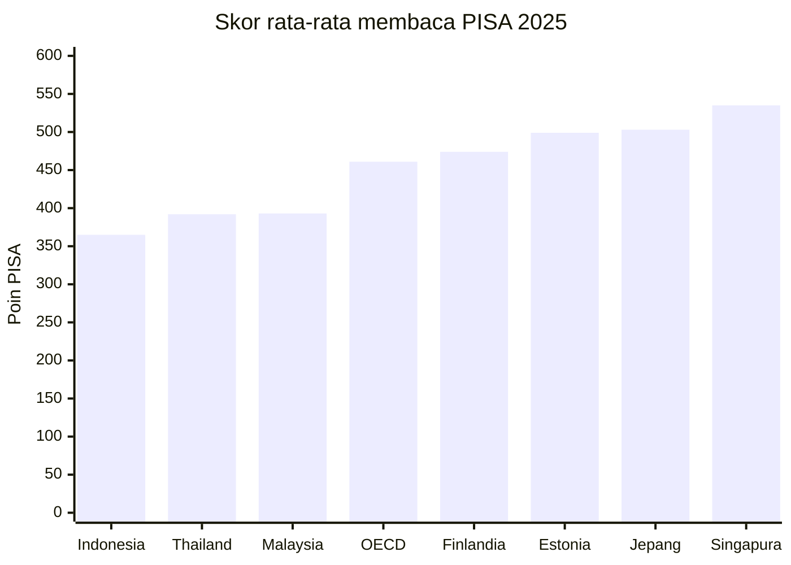
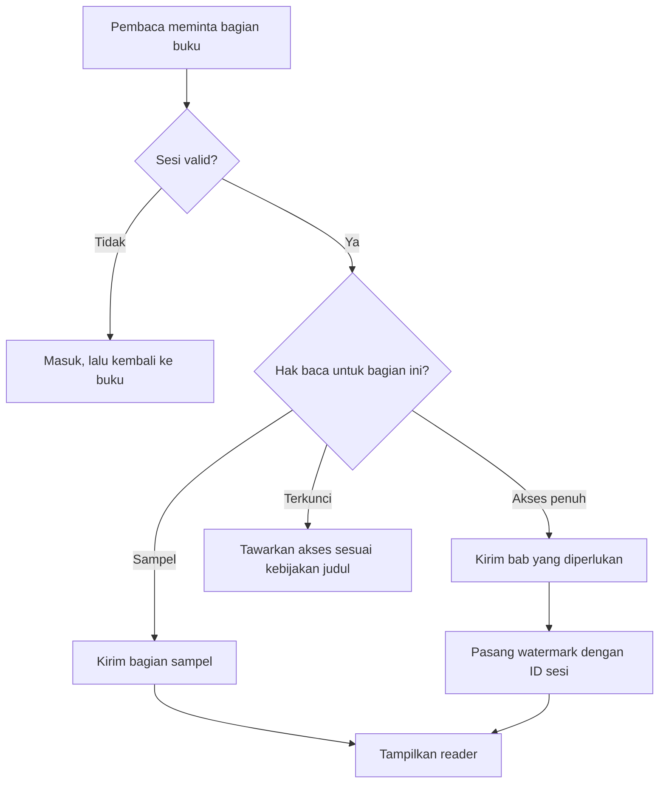
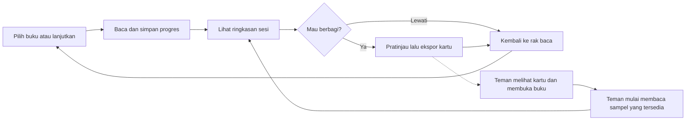
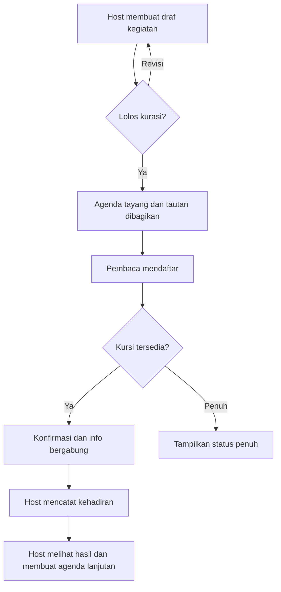
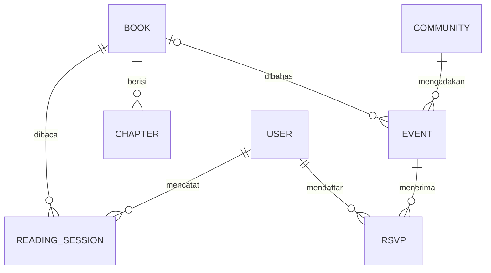

# Product Requirements Document — AnzaBook

**Versi 3.1 · 7 November 2026 · Baseline pengembangan dan pilot**

## 1. Ringkasan eksekutif

AnzaBook adalah platform baca untuk buku fiksi dan nonfiksi Indonesia. Penulis dan penerbit dapat menawarkan akses digital dengan aturan yang jelas. Pembaca bisa melanjutkan buku dari posisi terakhir, merayakan sesi baca atau buku yang tamat, lalu menemukan orang dan ruang untuk membacanya bersama.

Tiga masalah menentukan prioritas produk.

1. **DRM — Beri penulis kendali saat membawa buku cetak ke digital.** Dalam survei IKAPI pada 2021 terhadap lebih dari 130 penerbit, sekitar **75%** menemukan buku mereka dibajak dan dijual di lokapasar. Risiko kehilangan kendali atas salinan dapat membuat sebagian pemegang hak menahan distribusi digital. AnzaBook menawarkan penerbitan bertahap, pemeriksaan hak baca di server, dan cara menelusuri dugaan kebocoran. [IKAPI, survei pembajakan](https://www.ikapi.org/2023/05/20/pembajakan-buku-membunuh-kreativitas/). [UPI, studi kasus distribusi perpustakaan digital](https://repository.upi.edu/86240/3/S_PSPI_1606701_Chapter%201.pdf).
2. **Flex Your Literacy — Jadikan membaca kebiasaan yang terlihat.** Skor membaca Indonesia pada PISA 2025 adalah **365 poin**, dibandingkan **461 poin** rata-rata OECD. AnzaBook menguji gagasan yang terinspirasi dari Strava. Pembaca bisa memamerkan buku yang sedang dibaca, durasi, kutipan berizin, atau momen tamat lewat kartu **Flex Your Reading**. Teman yang melihatnya bisa membuka buku yang sama dan ikut membaca. [OECD, profil PISA 2025 Indonesia](https://gpseducation.oecd.org/CountryProfile?primaryCountry=IDN&topic=PI). [Strava, berbagi statistik aktivitas](https://support.strava.com/en-us/articles/15401840-sharing-your-strava-activities).
3. **Community Enabler — Bantu komunitas mengadakan kegiatan berulang.** Badan Bahasa mendata **1.291 komunitas literasi di 32 provinsi** pada 2024 dan melaporkan bahwa sebagian besar membiayai kegiatan secara mandiri. AnzaBook akan membantu penggerak komunitas dan taman bacaan masyarakat menerbitkan agenda, mengelola pendaftaran, mencatat kehadiran, dan mengundang peserta ke kegiatan berikutnya. [Badan Bahasa, Pembekalan Komunitas Literasi 2024](https://badanbahasa.kemendikdasmen.go.id/berita-detail/4349/kemendikbudristek-salurkan-bantuan-pemerintah-kepada-340-komunitas-pegiat-literasi).

**Status produk.** Fondasi katalog, reader, pemeriksaan hak baca, pencatatan progres, Share Studio, dan interaksi per buku sudah terlihat di repositori. Penguatan DRM, eksperimen kebiasaan baca, dan pilot alat komunitas masih menjadi pekerjaan berikutnya. Status di dokumen ini berdasarkan pemeriksaan kode, paket, dan dokumentasi repo.

## 2. Visi, misi, dan sasaran pengguna

**Visi.** Memperluas akses legal ke buku Indonesia, melindungi hak atas karya, dan menjadikan membaca kegiatan yang bisa dilakukan rutin, sendiri maupun bersama.

**Misi.** Menyediakan akses digital dan opsi cetak yang terjangkau. Memberi penulis kendali atas distribusi digital karyanya. Membantu pembaca membangun kebiasaan lewat progres yang bisa mereka lihat dan bagikan. Memperkuat kegiatan komunitas, perpustakaan, dan taman baca yang sudah berjalan.

**Tagline.** Aksara Tanpa Penjara Pikiran — Pustaka Digital & Edisi Cetak Rakyat.

- **Pembaca awal.** Mahasiswa dan pembaca dewasa muda yang ingin kembali membaca secara rutin. Mereka perlu menemukan bacaan, lanjut tanpa mencari halaman lagi, dan punya cara membagikan momen baca kepada teman.
- **Penulis dan penerbit awal.** Penulis independen dan penerbit kecil yang ingin menguji distribusi digital. Mereka perlu menetapkan bagian sampel, tahu siapa yang berhak membaca, dan punya jalur melaporkan dugaan kebocoran.
- **Penggerak komunitas.** Pengurus klub buku, taman bacaan masyarakat (TBM), dan perpustakaan mitra yang sudah mengadakan kegiatan. Mereka perlu satu halaman kegiatan yang dapat dibagikan dan alur pendaftaran yang ringan bagi relawan.

## 3. Riset masalah dan implikasi produk

### 3.1 Pembajakan buku dan keputusan menerbitkan edisi digital

- **Lokapasar dan PDF adalah jalur yang berbeda.** Survei IKAPI pada 2021 melibatkan lebih dari 130 penerbit. Sekitar 75% responden menemukan buku mereka dibajak dan dijual di lokapasar. Rilis IKAPI pada 2020 juga melaporkan kategori temuan selama pandemi: **54,2%** di lokapasar, **25%** melalui PDF gratis, dan **20,8%** mengalami keduanya. Rilis 2020 tidak menyebut ukuran sampelnya. Kedua survei menggambarkan pengalaman penerbit yang disurvei, tanpa mengukur persentase seluruh judul atau pembaca Indonesia. Perbedaan pertanyaan membuat keduanya kurang tepat dipakai sebagai tren. [IKAPI, survei 2021](https://www.ikapi.org/2023/05/20/pembajakan-buku-membunuh-kreativitas/). [IKAPI, rilis 2020](https://www.ikapi.org/2020/09/07/press-release-program-beli-buku-lokal/).
- **Penanganan di luar reader memerlukan bukti.** DJKI menangani **lebih dari 20 sengketa** hak cipta e-book dan karya tulis digital melalui mediasi dari 2022 hingga awal 2024. Pada Juli 2025, setelah memverifikasi laporan satu penerbit, DJKI merekomendasikan penutupan **15 akun dan situs**. Jumlah tersebut menunjukkan penanganan yang tercatat. Pindaian buku cetak dan unggahan di kanal lain tetap membutuhkan pelaporan dan tindak lanjut pemegang hak. [DJKI, data mediasi](https://www.dgip.go.id/index.php/artikel/detail-artikel-berita/tegas-berantas-pembajakan-buku-djki-jalin-kolaborasi-lintas-sektor?kategori=liputan-penyidikan-ki). [DJKI, rekomendasi penutupan](https://www.dgip.go.id/index.php/artikel/detail-artikel-berita/djki-menerbitkan-rekomendasi-pemblokiran-situs-bajakan-hak-cipta-buku-yang-dilaporkan-gramedia?kategori=liputan-penyidikan-ki).

#### Mengapa sebagian judul tetap terbit dalam format cetak

- **Risiko kehilangan kendali atas salinan.** Dalam studi kasus SiPINTAR, kepala Perpustakaan Universitas Islam Bandung melaporkan bahwa kekhawatiran penerbit akan pembajakan menjadi hambatan kerja sama distribusi koleksi digital. Setelah file lengkap beredar di luar kanal resmi, pemegang hak harus menemukan dan melaporkan salinannya. Kasus ini menunjukkan satu hambatan di jalur perpustakaan digital. Survei pembajakan IKAPI di atas mengukur temuan pelanggaran, sedangkan keputusan menunda e-book perlu diteliti langsung pada pemegang hak. [UPI, wawancara studi kasus SiPINTAR](https://repository.upi.edu/86240/3/S_PSPI_1606701_Chapter%201.pdf).
- **Pendapatan digital perlu sepadan dengan pekerjaan tambahan.** IKAPI menyebut penjualan buku digital masih di bawah **10%** dalam surveinya pada 2020. Angka historis itu memberi konteks mengapa penerbit bisa mengutamakan cetak. Untuk judul pilot, uji apakah perkiraan pendapatan dan kejelasan royalti sepadan dengan konversi format, pemeriksaan tata letak, dan pengelolaan distribusi digital. [IKAPI, Adaptasi Digitalisasi dan Tantangan Pembajakan](https://www.ikapi.org/2023/05/24/masa-depan-buku-di-indonesia-adaptasi-digitalisasi-dan-tantangan-pembajakan/).
- **Izin cetak dan izin digital perlu diperiksa per judul.** Saat merekrut judul cetak, cek siapa pemegang hak, cakupan lisensi yang sudah ada, persetujuan untuk sampel, dan ketentuan pendapatan. Dalam pilot, bedakan judul yang tertahan karena risiko kebocoran, kesepakatan hak, atau perhitungan bisnis. [Padjadjaran Law Review, studi lisensi penerbitan buku](https://jurnal.fh.unpad.ac.id/index.php/plr/article/view/1657).

**Batas DRM berbasis web.** Server dapat menolak permintaan yang tidak berhak dan membatasi bagian naskah yang dikirim. Peramban perlu menerima representasi konten untuk menampilkannya. Watermark dan overlay dapat menghambat penyalinan kasual. Standar Screen Capture W3C mengatur permintaan tangkap layar yang diajukan halaman dengan izin pengguna. Pembaca masih dapat merekam lewat sistem operasi atau kamera, menggunakan OCR, atau menginspeksi data yang diterima browser. [W3C, Screen Capture](https://www.w3.org/TR/2026/WD-screen-capture-20260716/).

**Implikasi untuk AnzaBook.** Tawarkan uji coba per judul. Pemegang hak dapat memulai dari sampel, membuka akses untuk pemilik kode buku fisik, atau menyetujui akses penuh lewat Nakama. Saat wawancara, catat alasan judul masih cetak dan syarat yang perlu dipenuhi agar pemegang hak bersedia membuka salah satu tingkat akses.

### 3.2 Kecakapan membaca, kegemaran membaca, dan kebiasaan

#### Posisi Indonesia dan negara pembanding

Dalam **PISA 2025**, skor rata-rata membaca siswa usia 15 tahun adalah **Indonesia 365**, **Thailand 392**, **Malaysia 393**, **rata-rata OECD 461**, **Finlandia 474**, **Estonia 499**, **Jepang 503**, dan **Singapura 535**. Indonesia terpaut **96 poin** dari rata-rata OECD dan **170 poin** dari Singapura. [OECD, PISA 2025, Tabel I.B1.2a.2](https://www.oecd.org/en/publications/pisa-2025-results-volume-i_73451bc5-en/full-report/results-for-countries-and-economies_33854635.html).

- **Kecakapan membaca.** **27%** siswa Indonesia mencapai minimal Level 2 pada PISA 2025, dibanding **69%** rata-rata OECD. Pada level itu siswa bisa menemukan gagasan utama dan informasi sesuai kriteria tertentu. Proporsi Indonesia pada 2022 adalah **25%**, dan OECD menilai skor rata-rata membaca Indonesia relatif sama antara kedua siklus. [OECD, PISA 2025 Indonesia](https://www.oecd.org/en/publications/pisa-2025-results-volume-i-country-notes_2d4ff9ea-en/indonesia_9c880f8a-en.html). [OECD, PISA 2022 Indonesia](https://www.oecd.org/en/publications/pisa-2022-results-volume-i-and-ii-country-notes_ed6fbcc5-en/indonesia_c2e1ae0e-en.html).
- **Melek aksara.** BPS mencatat **96,67%** penduduk Indonesia usia 15 tahun ke atas melek huruf pada 2024. Indikator ini mengukur kemampuan dasar membaca dan menulis kalimat sederhana. PISA menilai kecakapan memahami dan menggunakan teks pada siswa usia 15 tahun. Perbedaan populasi dan keterampilan yang diukur menjelaskan mengapa kedua angka memberi gambaran berbeda. [BPS, Indikator Kesejahteraan Rakyat 2024](https://www.bps.go.id/assets/publication/2024/11/06/3ef10d3d82ed93f616ba9113/indikator-kesejahteraan-rakyat-2024.html). [BPS, definisi angka melek huruf](https://sirusa.bps.go.id/sirusa/index.php/indikator/313).
- **Kegemaran membaca.** Survei Perpusnas 2025 yang dipublikasikan BPS mencatat indeks nasional **54,80**, dengan komponen pramembaca **50,05**, saat membaca **53,94**, dan pascamembaca **57,90**. Angka tersebut adalah skor indeks perilaku, dengan satuan yang berbeda dari persentase kecakapan PISA. PRD memakai data 2025 sebagai potret satu tahun. [BPS dan Perpusnas, Tingkat Kegemaran Membaca 2025](https://www.bps.go.id/id/statistics-table/3/TlROMldrTjVjVzEwVWtkbmRUSk5abkk0T0U5Q1FUMDkjMyMwMDAw/tingkat-kegemaran-membaca-masyarakat-dan-unsur-penyusunnya-menurut-provinsi.html?year=2025).

#### Apa yang dilakukan sistem pendidikan dengan skor lebih tinggi

- **Singapura menggabungkan pengajaran dan dukungan dini.** Program STELLAR memakai cerita di kelas untuk melatih membaca, berdiskusi, dan menulis. Siswa kelas 1 dan 2 yang masih kesulitan mendapat dukungan tambahan dalam kelompok kecil. Sekolah dan National Library Board juga menyediakan daftar bacaan dan kegiatan membaca bersama melalui kidsREAD. [MOE Singapura, kurikulum dan dukungan literasi](https://www.moe.gov.sg/-/media/files/news/press/2023/annex-c---moe-pirls-2021.ashx). [MOE Singapura, kemitraan untuk membaca](https://www.moe.gov.sg/-/media/files/news/press/2023/annex-d---moe-pirls-2021.pdf).
- **Jepang memperluas akses lewat sekolah dan perpustakaan.** Rencana pendidikan MEXT mendorong kerja sama sekolah dengan perpustakaan umum, penguatan perpustakaan sekolah, penyiapan guru pustakawan, dan lebih banyak kesempatan membaca bagi anak. [MEXT Jepang, Rencana Dasar Pendidikan Keempat](https://www.mext.go.jp/en/policy/education/lawandplan/20240311-ope_dev03-1.pdf).
- **Finlandia memasukkan literasi lintas pelajaran.** Kurikulum melatih siswa memahami dan menilai beragam jenis teks di berbagai mata pelajaran. Strategi nasional juga mendorong pembiasaan membaca dan penguatan literasi sepanjang hayat. [Badan Pendidikan Finlandia, literasi lintas pelajaran](https://www.oph.fi/en/education-and-qualifications/multiliteracy-and-media-literacy). [Strategi Literasi Nasional 2030](https://www.oph.fi/en/statistics-and-publications/publications/national-literacy-strategy-2030).

Contoh ini memperlihatkan tiga cara yang saling melengkapi: latihan memahami teks, akses ke bahan bacaan, dan kesempatan membaca bersama. PISA memberi pembanding hasil antarsistem. Kontribusi masing-masing program terhadap skor perlu dinilai dengan studi tersendiri. AnzaBook fokus pada akses legal dan kesempatan membaca rutin lewat reader, kartu Flex, dan agenda komunitas.

#### Dari FOMO lari ke kebiasaan membaca

**Pengamatan pendiri.** Ketika unggahan jarak, durasi, dan progres lari muncul berulang kali di lingkaran teman, lari terasa seperti kegiatan yang bisa diikuti. Orang bisa mulai karena penasaran atau takut ketinggalan momen bersama, lalu punya alasan untuk mengulang saat bisa melihat progres sendiri. Strava memberi cara untuk mencatat aktivitas dan membagikan statistiknya ke media sosial, termasuk sebagai stiker di Instagram Stories. [Strava, berbagi aktivitas](https://support.strava.com/en-us/articles/15401840-sharing-your-strava-activities). [Strava, stiker untuk Stories](https://support.strava.com/en-us/articles/17718841-how-do-i-share-my-strava-activity-to-instagram-stories-as-a-transparent-sticker).

- **Sinyal dari Indonesia.** Strava melaporkan partisipasi klub lari naik **83%** di Indonesia pada 2024, dibanding **59%** secara global. Laporan perusahaan menggambarkan tren komunitas yang diamatinya. Besarnya pengaruh fitur berbagi statistik terhadap tren lari di Indonesia belum diukur oleh angka tersebut. [Strava, Year in Sport 2024](https://press.strava.com/articles/strava-merilis-year-in-sport-laporan-tren).
- **Pengaruh teman punya bukti pada konteks lari.** Studi Aral dan Nicolaides menganalisis data sekitar **1,1 juta pelari** di sebuah jaringan sosial olahraga. Dengan memanfaatkan variasi cuaca, mereka memperkirakan tambahan **1 km** yang ditempuh teman berkaitan dengan tambahan **0,3 km** lari pada hari yang sama. Studi ini menguji perilaku di jaringan yang diteliti. Efek yang sama pada pengguna AnzaBook masih perlu diuji. [Aral dan Nicolaides, Nature Communications](https://www.nature.com/articles/ncomms14753).
- **Pencatatan progres layak diuji.** Meta-analisis Harkin dkk. terhadap **138 studi eksperimental** dengan **19.951 peserta** menemukan bahwa intervensi untuk memantau progres membantu pencapaian target dengan ukuran efek terstandar **d = 0,40** (IK 95% **0,32–0,48**). Efek cenderung lebih besar saat hasil dicatat atau dilaporkan ke orang lain. Studi mencakup beragam tujuan. Pengaruh berbagi kartu terhadap kebiasaan membaca di AnzaBook masih berupa hipotesis. [Harkin dkk., Psychological Bulletin](https://www.apa.org/pubs/journals/releases/bul-bul0000025.pdf).
- **Konteks berulang membantu rutinitas.** Dalam studi Lally dkk., **96 sukarelawan** memilih satu perilaku harian untuk diulang dalam konteks yang sama selama **12 minggu**. Estimasi waktu untuk mendekati tingkat otomatisasi maksimum bervariasi dari **18 sampai 254 hari** pada peserta dengan model yang sesuai. Perilaku yang diteliti mencakup makan, minum, atau aktivitas lain. Temuan ini mendukung pengujian rutinitas ringan dan ajakan kembali setelah melewatkan satu hari. [Lally dkk., European Journal of Social Psychology](https://doi.org/10.1002/ejsp.674).

**Hipotesis AnzaBook.** FOMO adalah rasa takut melewatkan pengalaman menyenangkan yang sedang dijalani orang lain. Di Flex Your Reading, pemicunya bisa sesederhana melihat teman membagikan buku yang sedang dibaca dan ingin ikut membacanya. Kartu memberi jalan ke halaman buku dan sampel yang tersedia. Setelah sesi pertama, posisi tersimpan dan progres pribadi memberi alasan untuk kembali. Berbagi tetap pilihan pembaca, dengan ruang untuk merayakan sesi singkat tanpa peringkat publik atau hukuman saat absen. [Przybylski dkk., studi tentang FOMO](https://doi.org/10.1016/j.chb.2013.02.014).

### 3.3 Pemberdayaan komunitas dan ruang baca

- **Ada jaringan penggerak yang sudah aktif.** Pada 2024 Badan Bahasa melaporkan **2.388 komunitas taman baca** tergabung dalam Forum TBM dan **1.291 komunitas literasi** terdata di 32 provinsi. Angka ini berasal dari dua pendataan dengan cakupan berbeda dan dapat beririsan. Program bantuan 2024 menjangkau **340 komunitas**, sementara sebagian besar komunitas yang disebut dalam laporan menjalankan kegiatan dengan dana mandiri. [Badan Bahasa, Pembekalan Komunitas Literasi 2024](https://badanbahasa.kemendikdasmen.go.id/berita-detail/4349/kemendikbudristek-salurkan-bantuan-pemerintah-kepada-340-komunitas-pegiat-literasi).
- **Ruang fisik dapat menjadi pintu masuk.** Perpusnas melaporkan bahwa program Transformasi Perpustakaan Berbasis Inklusi Sosial (TPBIS) menjangkau sekitar **13,9 juta orang secara kumulatif** sejak 2018 hingga laporan Juli 2026. Pada 2026 program dilaksanakan di **750 lokus**. Ini angka jangkauan program pemerintah dan mitra, dengan cakupan yang berbeda dari tingkat partisipasi berulang di suatu klub buku. [Perpusnas, siaran pers TPBIS 2026](https://perpusnas.go.id/berita/siaran-pers-tpbis-telah-menjangkau-13-9-juta-masyarakat-dan-mengubah-cara-pandang-terhadap-perpustakaan).
- **Menemukan kegiatan bisa menjadi hambatan lokal.** Laporan pendampingan TBM Matahari di Tulungagung mengaitkan rendahnya kunjungan dengan kurangnya promosi layanan. Kegiatan sosialisasinya melibatkan **40 orang tua dan anak**. Hasil dari satu lokasi memberi alasan untuk menguji apakah agenda yang mudah dibagikan membantu orang menemukan kegiatan setempat. [Juvitasari dkk., laporan pendampingan TBM Matahari](https://ejournal.unma.ac.id/index.php/bernas/article/view/16955).

**Implikasi untuk AnzaBook.** Rekrut penyelenggara yang sudah punya agenda. Petakan waktu yang mereka habiskan untuk mengurus peserta, alat yang mereka pakai, dan data yang mereka perlukan setelah acara. Uji apakah halaman agenda, RSVP, dan daftar hadir mengurangi pekerjaan tersebut. Besarnya jaringan komunitas belum menjawab apakah relawan ingin menambah alat baru.

## 4. Fitur inti dan kriteria penerimaan

**P0** adalah kebutuhan menuju pilot. **P1** diuji setelah alur P0 berjalan. **P2** adalah pengembangan lanjutan. Kriteria di bawah mendefinisikan perilaku yang dituju.

### 4.1 P0 · DRM dan hak akses baca

**Ada di repo.** Reader web yang memerlukan login, pemeriksaan hak akses, sampel untuk buku premium, akses melalui Nakama atau klaim buku fisik, dan `Cache-Control: private, no-store` pada API. Respons reader saat ini mengirim teks bab yang diizinkan dalam JSON dan dapat memuat seluruh bab melalui mode baca kontinu untuk akun berhak. Jika diaktifkan dari reader, Shield menampilkan watermark berisi email, potongan ID akun, dan waktu, serta merespons beberapa interaksi browser. [Endpoint buku](apps/api/src/routes/books.routes.ts). [Layanan buku](apps/api/src/services/books.service.ts). [Kebijakan cache](apps/api/src/middleware/no-store.ts). [Komponen Shield](apps/web/src/features/reader/components/drm-shield.tsx).

- **DRM-01 · Cek hak baca di server.** Tanpa sesi, endpoint reader menolak permintaan. Akun dengan akses sampel hanya menerima bagian yang diizinkan. Nakama aktif atau klaim sah membuka bagian sesuai kebijakan judul. Kedaluwarsa atau pencabutan hak berlaku untuk permintaan berikutnya. Uji akses langsung ke API, termasuk bab terkunci, mode kontinu, dan audio jika tersedia.
- **DRM-02 · Batasi naskah yang dikirim.** Sajikan bab yang dibuka dengan jendela prefetch terbatas. Cegah naskah premium masuk ke payload publik, cache bersama, atau log. Batasi pengambilan berulang yang tidak wajar dengan ambang berdasarkan pengujian baca normal. Audio premium, bila disajikan lewat tautan bertanda tangan, mengikuti pemeriksaan hak akses dan masa berlaku.
- **DRM-03 · Watermark dan laporan.** Ganti email pada tampilan dengan ID sesi acak yang dapat ditelusuri petugas berwenang. Pemegang hak dapat melaporkan URL dan bukti. Tim meninjau kecocokan judul, waktu, dan watermark sebelum menindaklanjuti. Kehilangan fokus dan shortcut browser tidak menjadi dasar tunggal untuk memblokir akun.
- **DRM-04 · Lindungi pengalaman baca.** Keyboard, pembaca layar, highlight pribadi, dan kelanjutan posisi baca tetap berfungsi. Jika overlay aktif, fokus berpindah ke aksi **Lanjutkan membaca** dan kembali ke posisi semula sesudahnya. Uji pemicu keliru, pergantian tab, dan perangkat seluler.
- **DRM-05 · Beri pemegang hak pilihan penerbitan.** Tim kurasi mencatat persetujuan dan tingkat akses per judul. Pilihan pilot mencakup sampel saja, akses penuh lewat klaim buku fisik, atau akses penuh lewat Nakama sesuai perjanjian. Catat batas sampel serta izin dan panjang kutipan secara terpisah. Untuk judul tanpa izin kutipan publik, kartu Flex menawarkan sampul yang diizinkan, judul, penulis, dan progres tanpa teks naskah. Portal mandiri penulis dan evaluasi batas sesi konkuren masuk P1.

### 4.2 P0 · Flex Your Literacy / Flex Your Reading

**Ada di repo.** Rak baca, penyimpanan posisi, sesi baca, highlight, dan ekspor visual berbasis Canvas. Share Studio memiliki templat stiker, struk, dan kutipan. Dukungan share sheet bergantung pada perangkat, dengan unduh gambar sebagai jalur cadangan. [Layanan baca](apps/api/src/services/reading.service.ts). [Share Studio](apps/web/src/features/share/components/share-studio-panel.tsx). [Dialog Flex Your Reading](apps/web/src/features/share/components/flex-reading-dialog.tsx).

- **FLEX-01 · Mulai kecil dan bisa lanjut.** Pembaca bisa membuka buku dari posisi terakhir dan melihat sesi terbaru. Hitung estimasi durasi dari waktu reader aktif dengan batas saat tidak ada aktivitas. Simpan sesi tanpa hitung ganda ketika pengiriman diulang. Progres tidak hilang jika tab ditutup sebelum kartu dibuat.
- **FLEX-02 · Rayakan momen yang berbeda.** Pembaca bisa mengekspor kartu sedang baca, ringkasan sesi, atau momen tamat. Kartu kutipan tersedia sesuai DRM-05 dengan atribusi judul dan penulis. Ringkasan periodik masuk P1 setelah definisi sesi stabil.
- **FLEX-03 · Pembaca memilih apa yang dibagikan.** Aktivitas bersifat privat secara default. Pratinjau menampilkan data yang akan masuk ke gambar dan pembaca bisa menyembunyikan durasi atau progres. Kartu tidak membawa email, ID akun, watermark internal, lokasi presisi, atau tautan yang membuka bab premium. Jika share sheet tidak mendukung gambar, tampilkan unduhan PNG.
- **FLEX-04 · Ajak kembali membaca.** Setelah ekspor atau saat pengguna melewatinya, tampilkan aksi lanjut membaca. Streak, bila ditampilkan, berfungsi sebagai catatan pribadi. Pengukuran pilot memprioritaskan hari baca aktif dan retensi dibanding jumlah unggahan atau kecepatan membaca.
- **FLEX-05 · Ubah rasa penasaran jadi sesi pertama.** Pembaca bisa menyertakan tautan buku publik saat membagikan kartu. Teman yang membuka tautan melihat judul yang sama dan aksi **Baca sampel** jika tersedia. Jika reader memerlukan login, bawa pembaca kembali ke judul tersebut setelah masuk. Sebagai contoh, kartu _“Hari ini baca 12 menit”_ cukup untuk memulai percakapan tanpa menunggu buku tamat.

### 4.3 P0 · Community Enabler

**Ada di repo.** Ulasan dan marginalia, yaitu komentar per paragraf yang mengikuti batas akses reader. Agenda, pendaftaran, dan alat pengelolaan untuk host adalah lingkup pilot. [Endpoint buku dan interaksi](apps/api/src/routes/books.routes.ts). [Layanan komunitas](apps/api/src/services/community.service.ts).

- **COM-01 · Terbitkan agenda.** Host yang disetujui membuat profil komunitas dan draf acara gratis berisi jenis acara, waktu dan zona waktu, kuota, format, serta judul buku opsional. Mulai dari bedah buku dan baca bareng. Tim meninjau draf sebelum halaman publik terbit.
- **COM-02 · Daftar dan batalkan.** Pembaca menemukan acara dari direktori atau tautan undangan. Satu akun punya satu pendaftaran aktif per acara. Dua permintaan serentak tidak boleh melampaui kuota. Setelah daftar, peserta menerima konfirmasi dan informasi bergabung. Peserta dapat membatalkan agar kursi kembali tersedia.
- **COM-03 · Kelola acara dan privasi.** Host berwenang melihat daftar minimum peserta dan menandai kehadiran. Perubahan jadwal atau pembatalan memberi tahu peserta. Tautan rapat privat hanya ditampilkan ke peserta terdaftar. Halaman publik menyediakan cara melaporkan acara.
- **COM-04 · Bantu host mengulang kegiatan.** Setelah acara selesai, tampilkan jumlah pendaftar dan peserta hadir serta aksi membuat agenda lanjutan. Pengingat H-1, Creator Stage untuk peluncuran buku dan Q&A, sesi nulis bareng, serta direktori Sudut Baca terkurasi masuk P1. Tiket berbayar dan check-in lokasi untuk kartu Flex masuk P2.

## 5. Fitur pendukung dan lingkup

- **Katalog dan reader.** Detail buku, rak pribadi, mode scroll dan halaman, serta preferensi tampilan. Mode dwibahasa, ringkasan, dan audio bergantung pada data dan hak yang tersedia per judul.
- **Keanggotaan Nakama.** Paket 3, 6, dan 12 bulan, checkout Midtrans/QRIS, dan akses setelah verifikasi pembayaran di server. Dokumentasi pengujian memakai sandbox. Aktivasi produksi memerlukan konfigurasi dan verifikasi terpisah. [Panduan Nakama](docs/anzabook-membership.md).
- **Cetak Rakyat.** Pertahankan opsi Cetak Rakyat, Standar, dan Kolektor pada judul yang menyediakan edisi fisik, serta klaim akses digital dengan kode sekali pakai untuk judul yang memenuhi syarat. Kalkulator penerbit membantu simulasi biaya. Harga dan margin publik perlu data biaya per judul. Tampilan stok memakai data cabang dan waktu pembaruan di basis data. Sinkronisasi otomatis menunggu konfirmasi mitra dan integrasi sumber inventori.
- **Operasional penerbit dan komunitas.** Pilot memakai kurasi manual. CMS naskah, laporan royalti dan pencairan, inventori mitra, ulasan lokasi, tiket berbayar, serta akses premium offline memerlukan keputusan dan pengujian tersendiri.

## 6. Pengukuran dan rencana validasi

**Metrik utama.** Persentase pembaca yang menyelesaikan sesi baca valid pertama, lalu membaca pada minimal **dua hari berbeda di minggu keempat** setelah aktivasi. Definisi awal sesi valid untuk pilot adalah minimal dua menit reader aktif dan ada kemajuan posisi. Gunakan zona waktu yang ditetapkan secara konsisten dan denominator berupa seluruh pembaca teraktivasi dalam kohor yang sudah menuntaskan jendela observasi. Laporkan ukuran kohor bersama hasil.

- **DRM.** Ukur kelulusan skenario akses, laporan dugaan kebocoran yang dapat ditelusuri, waktu peninjauan, dan gangguan overlay. Untuk melihat apakah DRM membantu judul cetak masuk ke digital, catat berapa judul cetak yang ditawari pilot, berapa yang akhirnya terbit di tiap tingkat akses, dan alasan penundaan atau penolakan. Gerbang pilot adalah nol skenario uji akses ilegal yang berhasil dalam matriks sesi, sampel, klaim, kedaluwarsa, dan akses langsung ke API.
- **Flex · Teman yang melihat kartu.** Pantau alur kunjungan dari tautan Flex yang dapat diatribusikan, pembukaan sampel, dan sesi valid pertama. Untuk menguji pengaruh sosial secara terpisah, bagi peserta pilot secara acak. Satu kelompok melihat kartu progres asli yang dibagikan atas izin pembaca. Kelompok lain melihat informasi judul yang sama dengan aksi baca yang sama. Bandingkan persentase peserta yang mencapai sesi valid pertama. Klik tautan mengukur minat awal, sedangkan sesi valid mengukur apakah orang mulai membaca.
- **Flex · Pembaca yang membuat kartu.** Acak akun setelah sesi valid pertama dan amati selama empat minggu. Kedua kelompok mendapat reader dan ringkasan progres yang sama, sementara satu kelompok mendapat kartu berbagi. Bandingkan jumlah hari baca dan retensi minggu keempat berdasarkan kelompok penugasan. Pantau rasio ekspor dan wawancarai pembaca soal alasan mereka kembali atau merasa tertekan. Gunakan hasil pilot kecil untuk menilai kelayakan dan menentukan ukuran studi berikutnya.
- **Komunitas.** Mulai dengan **3–5 komunitas** yang sudah punya agenda rutin sebagai target rekrutmen pilot. Bandingkan waktu administrasi host sebelum dan selama pilot. Ukur kehadiran per pendaftar aktif, peserta yang kembali, dan proporsi host yang menerbitkan kegiatan kedua dalam 30 hari. Catat pembatalan dan variasi antarformat agar rata-rata tidak menyembunyikan masalah.

Angka sesi, kohor, dan rekrutmen di atas adalah usulan desain pilot. Target kenaikan retensi, tingkat kehadiran, dan penghematan waktu ditetapkan setelah pengukuran baseline serta sebelum evaluasi pilot.

## 7. Arsitektur, stack, dan data

- **Web — `apps/web`.** TanStack Start dengan SSR, React 19, TanStack Router dan Query, Tailwind CSS v4, shadcn/ui, serta Canvas untuk ekspor kartu.
- **API — `apps/api`.** Express 5 dan TypeScript. Better Auth memakai sesi berbasis cookie. Route menangani autentikasi dan validasi, service memutuskan hak akses dan menjalankan logika produk, serta Drizzle mengakses PostgreSQL. Role yang dideklarasikan saat ini adalah `user` dan `admin`. Sebelum pilot, API perlu membatasi izin host ke komunitas yang dikelolanya dan membatasi kurasi ke moderator yang berwenang. Izin penulis ditetapkan saat portal penerbit dikembangkan.
- **Data dan kontrak.** PostgreSQL 17 untuk lingkungan pengembangan melalui Docker Compose. Skema dan migrasi Drizzle berada di `apps/api`. `packages/shared` memuat validator Zod, tipe respons API, aturan bersama, dan RBAC. Workspace memakai pnpm dan Turborepo.
- **Integrasi.** Midtrans/QRIS untuk Nakama. Penyedia rapat, peta, dan sinkronisasi stok dipilih sesuai kebutuhan pilot atau konfirmasi mitra. [Arsitektur repo](docs/architecture.md). [Paket web](apps/web/package.json). [Paket API](apps/api/package.json). [Konfigurasi PostgreSQL lokal](compose.dev.yaml). [Definisi izin](packages/shared/src/permissions.ts).

**Model data.** Katalog sudah memiliki buku, bab, edisi fisik, kode klaim, cabang, dan inventori. Data baca mencakup sesi, progres, rak, highlight, ulasan, dan komentar per paragraf. Untuk pilot, tambahkan konsep komunitas, acara, RSVP, serta catatan watermark atau laporan seperlunya. Nama entitas di diagram berikut bersifat konseptual.

## 8. Persyaratan nonfungsional dan gerbang rilis

- **Privasi dan hak cipta.** Catat izin distribusi dan kutipan per judul. Minimalkan data di watermark, ekspor, dan daftar peserta. Tetapkan tujuan, durasi retensi, kontrol akses, dan proses penghapusan untuk data baca serta laporan sebelum pilot. Tinjau kewajiban terkait dengan pemegang hak dan tim yang bertanggung jawab. [UU No. 28 Tahun 2014 tentang Hak Cipta](https://peraturan.bpk.go.id/Details/38690/uu-no-28-tahun-2014). [UU No. 27 Tahun 2022 tentang Pelindungan Data Pribadi](https://peraturan.bpk.go.id/Details/229798/uu-no-27-tahun-2022.).
- **Aksesibilitas dan perangkat.** Uji reader, ekspor kartu, dan RSVP dengan keyboard, pembaca layar, zoom, serta layar sempit. Cakup Chrome dan Edge di desktop, Safari di iOS, dan Chrome di Android. Ukur waktu buka reader dan ekspor pada ponsel serta koneksi pilot sebelum menetapkan target kinerja.
- **Konsistensi.** Uji klaim ganda, pencatatan sesi setelah retry, pendaftaran serentak saat satu kursi tersisa, dan pembatalan acara. Posisi baca harus tetap tersedia ketika pengguna melanjutkan di perangkat lain. Uji alur ini dari browser ke API dan basis data.
- **Gerbang rilis.** Selesaikan uji akses konten dan privasi kartu, verifikasi alur host hingga kehadiran, siapkan jalur bantuan bagi penerbit dan pembaca, dan pastikan pengukuran baseline bisa direproduksi. Untuk perubahan aplikasi, jalankan pemeriksaan repo serta uji end-to-end pada alur yang berubah.

## 9. Roadmap dan keputusan terbuka

1. **Fondasi saat ini.** Katalog, reader dan kontrol akses awal, Share Studio, progres baca, interaksi per buku, edisi cetak, serta integrasi Nakama di lingkungan yang dikonfigurasi.
2. **Pilot tiga pilar.** Uji distribusi judul berizin dengan DRM yang diperkuat, pengaruh kartu Flex terhadap frekuensi membaca, dan alur agenda gratis dari publikasi sampai pencatatan kehadiran. Lanjutkan jika gerbang akses dan privasi lulus serta hasil pilot cukup untuk menentukan iterasi berikutnya.
3. **Perluasan setelah pilot.** Uji Creator Stage, pengingat acara, dan Peta Sudut Baca terkurasi. Jadwalkan backoffice penerbit, royalti otomatis, tiket berbayar, integrasi POS, dan akses offline setelah kebijakan, hak, dan kesiapan mitra tervalidasi.

Keputusan yang perlu dicatat sebelum pilot mencakup judul dan mitra awal, kebijakan sampel dan kutipan, definisi durasi aktif serta perlakuan untuk audiobook, retensi data, dan penanggung jawab kurasi serta penanganan laporan.
