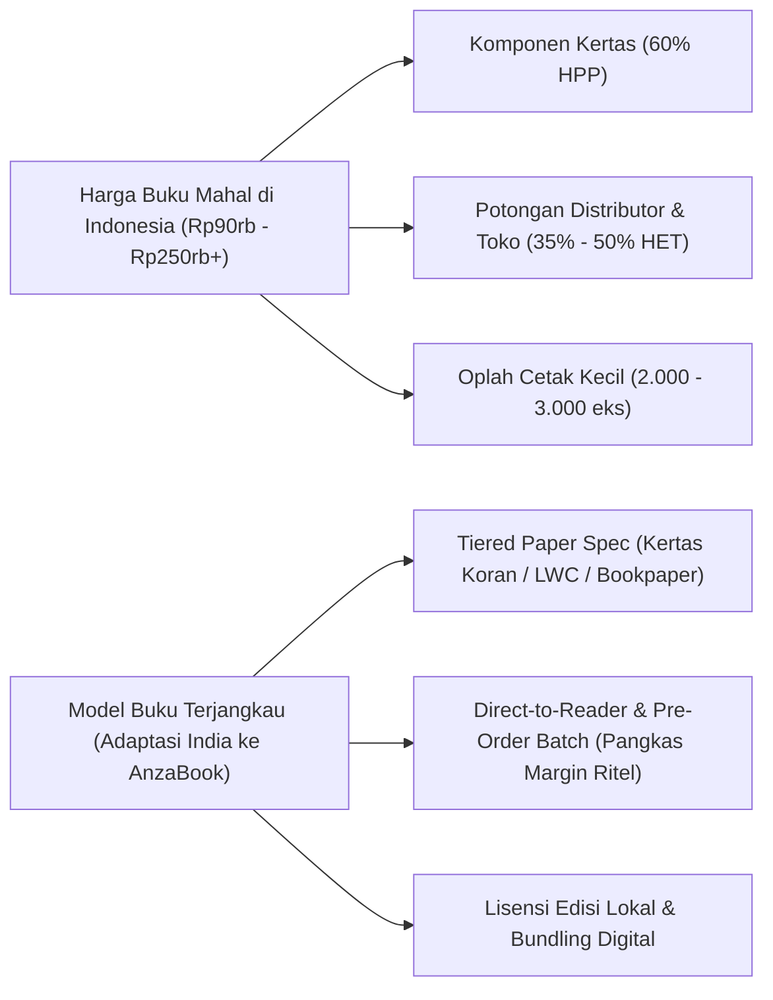
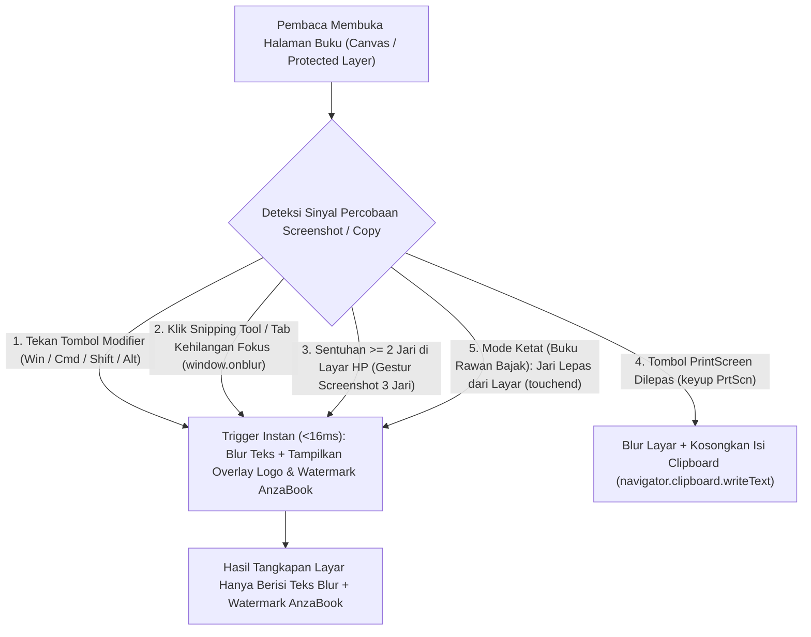
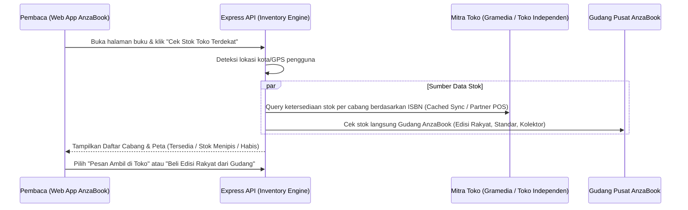

# Product Requirements Document (PRD): AnzaBook
**Versi:** 1.1 (Updated: Tech Stack Monorepo, Web Pre-Trigger DRM & Strava-Style Share Studio)  
**Tanggal:** 31 Oktober 2026  
**Status:** Siap Review Final Sebelum Masuk Tahap Implementation Plan

---

## Bagian 1: Hasil Riset & Reverse Engineering

Sebelum masuk ke spesifikasi fitur dan teknis, bagian ini membedah empat pilar riset yang menjadi fondasi produk dan model bisnis AnzaBook.

### 1.1 Reverse Engineering: Malaka Books (`malakabooks.id`)
Malaka Books memposisikan diri sebagai penerbit sekaligus platform baca digital berbasis langganan (SaaS literasi) yang menargetkan pembaca modern dengan rentang perhatian (*attention span*) pendek namun membutuhkan substansi padat.

* **Arsitektur Konten (Micro-Book / Ringkas):** Buku dikemas dalam format 20 hingga 30 halaman per judul (durasi baca sekitar 45 hingga 60 menit). Fokus pada nonfiksi populer: filsafat praktis (*The Thinking Blueprint*), psikologi, ekonomi, sains, dan karier.
* **Fitur Utama Reader & Eksplorasi:**
  * **Bilingual / Multi-Language Reading:** Tersedia buku berbahasa Inggris dan fitur baca dwibahasa (Indonesia, Inggris, Jepang, Jerman, Korea) untuk memperkaya kosakata sambil membaca.
  * **Weekly Bulletin:** Kurasi editorial mingguan di bagian teratas halaman utama (*Home*) untuk mendorong buku yang relevan dengan isu terkini, dilengkapi tombol bagikan sekali ketuk (*one-tap share*).
  * **Quote Sharing ke Media Sosial:** Pembaca bisa melakukan *highlight* kalimat dan langsung mengekspornya menjadi kartu kutipan visual untuk Instagram Story atau X.
  * **Progress Tracker & Auto-Resume:** Melacak persentase bacaan dan membuka kembali halaman terakhir lintas perangkat.
* **Model Monetisasi (Tiered Subscription):**
  * Sebagian buku gratis sebagai *lead magnet*, sedangkan katalog penuh dibuka lewat iuran keanggotaan:
    * Paket 3 Bulan: Rp80.000 (~Rp26.667/bulan)
    * Paket 6 Bulan: Rp140.000 (~Rp23.333/bulan)
    * Paket 12 Bulan: Rp240.000 (~Rp20.000/bulan)
* **Celah Strategis untuk AnzaBook:** Malaka Books kuat di nonfiksi pendek digital, namun belum menggabungkan katalog fiksi/novel panjang, ekosistem sosial sekelas Goodreads, fitur *Flex Your Read* bergaya Strava, opsi cetak fisik berlapis (*tiered print*), serta pelacakan stok toko buku secara *real-time*.

---

### 1.2 Riset Ekonomi Perbukuan: Mengapa Buku di India Sangat Murah dibanding AS & Indonesia?

Fenomena buku yang dijual seharga $30 hingga $150 di Amerika Serikat namun dijual hanya Rp25.000 hingga Rp60.000 (INR 150 hingga 400) di India bukan semata-mata karena subsidi pemerintah, melainkan kombinasi **strategi lisensi teritorial, rekayasa spesifikasi kertas, dan pemangkasan rantai distribusi**.

#### A. 4 Faktor Kunci Buku Murah di India (*Indian Subcontinent Edition*)
1. **Spesifikasi Kertas & Cetak Ekonomis (*Engineered Downgrade*):**
   * Edisi Barat memakai kertas bebas asam (*acid-free archival paper*) tebal (70 hingga 80 gsm) dan sampul *hardcover*.
   * Edisi India (*Eastern Economy Edition*) menggunakan kertas ringan berbiaya rendah (45 hingga 55 gsm *newsprint* / kertas koran berkualitas baca atau *low-grade wood-free paper*), cetak isi hitam-putih penuh (*grayscale*), dan sampul *paperback* tipis dengan penjilidan lem panas standar. Biaya bahan baku turun hingga 50% sampai 65%.
2. **Lisensi Teritorial (*Price Discrimination / Purchasing Power Parity*):**
   * Penerbit global (Pearson, Penguin, HarperCollins) melisensikan pencetakan langsung di percetakan lokal India dengan label tegas: *"For Sale in the Indian Subcontinent Only"*. Daripada buku dibajak 100% karena tidak terjangkau, penerbit memilih margin tipis per eksemplar namun volume penjualan jutaan kopi.
3. **Lembaga Penerbitan Publik & Regulasi Pajak:**
   * Pemerintah India memiliki **National Book Trust (NBT)** dan **Publications Division** yang mencetak buku literasi dan sastra dengan harga sangat murah. Selain itu, buku cetak di India dibebaskan dari GST (0% GST untuk buku fisik).
4. **Perbandingan dengan Masalah di Indonesia:**
   * Di Indonesia, PMK Nomor 5/PMK.010/2020 membebaskan PPN untuk buku pelajaran umum, kitab suci, dan buku agama, namun buku umum/novel sering kali masih terkena beban pajak di hulu (bahan baku kertas & PPh royalti penulis).
   * **Penyebab utama mahalnya buku di Indonesia (Rp90.000 hingga Rp250.000+):**
     1. **Kertas memakan ~60% Biaya Produksi (HPP):** Penerbit lokal rata-rata hanya menawarkan satu jenis cetakan (Bookpaper 57.5/72 gsm impor atau HVS 70 gsm).
     2. **Potongan Toko Buku & Distributor (35% hingga 50% dari harga jual):** Jika biaya cetak buku hanya Rp18.000, harga jual di toko fisik harus dipasang Rp90.000 hingga Rp100.000 agar menutup komisi distributor (40% hingga 50%), royalti penulis (10%), dan margin penerbit.
     3. **Oplah Cetak Kecil (2.000 hingga 3.000 eksemplar):** Biaya persiapan cetak (*fixed cost* plat offset) dibagi ke jumlah buku yang sedikit.

#### B. Implementasi untuk Penerbitan AnzaBook (*Multi-Format & Tiered Paper Publishing*)
AnzaBook memecahkan masalah harga buku mahal di Indonesia dengan menawarkan **3 Tier Fisik + 1 Tier Digital** saat penulis menerbitkan buku atau saat pembaca membeli:

| Tier Format | Spesifikasi Material | Estimasi Harga Jual | Target Pembaca | Saluran Distribusi |
| :--- | :--- | :--- | :--- | :--- |
| **1. Digital / SaaS Access** | E-Book & Audiobook terenkripsi di Web App | Rp20.000/bln (Langganan) atau Rp25.000/judul | Komuter, pembaca digital, pelajar | Web App AnzaBook |
| **2. Edisi Rakyat (Pocket / Economy Print)** | Kertas Koran Halus (*Novel Newsprint* 48.8 gsm) atau Bookpaper tipis 52 gsm, ukuran saku A6/B6, *softcover* ringan | **Rp29.000 - Rp45.000** | Pelajar, mahasiswa, gerakan literasi daerah | Direct-to-Consumer (Web App AnzaBook) & Komunitas (tanpa potongan 45% toko ritel) |
| **3. Edisi Standar (Trade Paperback)** | Bookpaper 57.5 gsm / 72 gsm ramah mata, ukuran A5/UNESCO, *softcover* doff/glossy | **Rp75.000 - Rp99.000** | Pembaca umum & pembeli toko buku | Toko Buku Fisik (Gramedia, mitra) & Online |
| **4. Edisi Kolektor (Hardcover / Special)** | Bookpaper 72/80 gsm / Art Paper, *hardcover*, pita pembatas, jaket buku, tanda tangan penulis | **Rp149.000 - Rp225.000** | Kolektor, penggemar berat penulis | Pre-order eksklusif & stok terbatas di toko |

---

### 1.3 Teardown Goodreads + "Strava for Reading" (Social & Habit Loop)

Goodreads bertahan karena *database* buku, tetapi tampilannya usang dan kurang memicu kebanggaan sosial (*social flexing*) di era Instagram Story, X, dan Threads. AnzaBook menggabungkan fondasi katalog Goodreads dengan psikologi kebiasaan **Strava**:

| Pilar Fitur | Cara Kerja di Goodreads | Inovasi di AnzaBook (Goodreads + Strava Loop) |
| :--- | :--- | :--- |
| **Digital Shelves (Rak Buku)** | 3 rak wajib (*Want to Read, Currently Reading, Read*) + rak kustom | Rak otomatis sinkron dengan progres *in-app reader* dan buku fisik yang dipindai lewat ISBN/barcode |
| **Flex Your Read (Strava-Style Share)** | Tidak ada fitur kartu visual aktivitas membaca harian | Selesai satu sesi baca, muncul ringkasan metrik (**Durasi Baca, Halaman Diselesaikan, Kecepatan Baca/WPM, Streak Harian**) yang bisa diekspor menjadi **Stiker PNG Transparan** (untuk ditempel di atas foto kopi/buku di IG Story) atau Kartu Editorial siap unggah |
| **Rating & Review** | Skala 1 sampai 5 bintang bulat; rawan *review bombing* | Rating desimal (0.5 step), lencana **"Verified Reader"** (otomatis jika menyelesaikan >70% di app atau klaim kode unik buku cetak), dan *structured review* |
| **Social Feed & Diskusi** | Forum grup model lama terpisah dari isi buku | **Inline Paragraph Discussion (Marginalia):** Pembaca bisa meninggalkan reaksi dan diskusi tepat di samping paragraf tertentu (dengan pelindung *spoiler*) |

---

### 1.4 Arsitektur Pure Web DRM: Pre-Trigger Blur & Watermark AnzaBook

Karena AnzaBook dibangun sebagai **Pure Web App**, perlindungan terhadap *copy-paste* dan *screenshot* bekerja menggunakan mekanisme **Pre-Trigger Shield + Dynamic Watermark Overlay**:

1. **Anti Copy-Paste & Inspect Element:**
   * Seluruh area baca menggunakan `user-select: none`, pemblokiran event `copy`, `cut`, `contextmenu` (klik kanan), dan `Ctrl+P` (cetak halaman).
   * Teks buku dikirim dari Express API dalam bentuk potongan terenkripsi (*encrypted chunks*) per halaman dan dirender ke dalam elemen `<canvas>` (atau *obfuscated DOM layer*), sehingga tidak bisa disalin lewat *Inspect Element*.
2. **Pre-Trigger Screenshot Blur + Watermark AnzaBook:**
   * **Desktop Shortcut Interception:** Saat pengguna menekan tombol awal kombinasi screenshot (`Meta`/`Win`, `Cmd`, `Shift`, `Alt`), state komponen baca langsung berubah dalam `<16ms` menjadi `filter: blur(18px)` disertai kemunculan lapisan **Logo AnzaBook + Teks Peringatan Hak Cipta + ID Akun Pembaca**.
   * **Focus Loss Shield:** Saat pengguna mengklik aplikasi Snipping Tool atau berpindah jendela (`blur` / `visibilitychange`), layar baca otomatis ter-blur penuh dan menampilkan watermark AnzaBook.
   * **Mobile Multi-Touch Shield:** Saat pengguna di browser HP menempelkan 2 atau 3 jari untuk melakukan gestur screenshot usap 3 jari (`touchstart` dengan `touches.length >= 2`), layar langsung mem-blur teks dan memunculkan watermark sebelum OS menangkap gambar.
   * **PrintScreen Clipboard Wipe:** Jika tombol tunggal `PrintScreen` ditekan, begitu event terdeteksi, Web App langsung menimpa *clipboard* dengan teks peringatan hak cipta AnzaBook dan mem-blur layar.
   * **Mode "Hold-to-Read / Spotlight" (Opsional untuk Buku Cetak Baru/Sensitif):** Untuk buku yang sangat rawan dibajak, teks hanya tajam ketika jari menyentuh layar atau kursor berada di area baca; begitu jari diangkat untuk menekan tombol fisik `Power + Volume Down` di HP, teks otomatis kembali blur beserta watermark AnzaBook.

---

### 1.5 Arsitektur Live Tracking Stok Buku Cetak (Gramedia & Toko Mitra)

---

## Bagian 2: Spesifikasi Teknis & Tech Stack (Starter Monorepo)

Sesuai referensi arsitektur yang dipilih, AnzaBook dibangun menggunakan struktur **Starter Monorepo (Express API + TanStack Start)**:

| Komponen | Teknologi | Peran di Ekosistem AnzaBook |
| :--- | :--- | :--- |
| **Monorepo Manager** | **pnpm Workspaces + Turborepo** | Mengelola aplikasi frontend (`apps/web`), backend (`apps/api`), dan paket bersama (`packages/db`, `packages/shared`, `packages/ui`) dalam satu repositori. |
| **Frontend Framework** | **TanStack Start** (React + TanStack Router + TanStack Query) | Menyediakan SSR untuk SEO halaman katalog buku & ulasan komunitas, *type-safe routing*, serta manajemen *cache* data stok dan progres baca yang responsif. |
| **Styling & UI** | **Tailwind CSS** | Sistem desain berbasis token yang bersih, tipografi ruang baca yang nyaman, dan kepatuhan penuh terhadap standar anti-slop (`AGENTS.md`). |
| **Backend API** | **Express.js (TypeScript)** | Melayani pengiriman potongan buku terenkripsi (*encrypted book chunks*), streaming metadata audiobook, kalkulator HPP percetakan, serta sinkronisasi stok toko buku. |
| **Authentication** | **Better Auth** | Mengelola autentikasi multi-perangkat, pembatasan jumlah sesi aktif (mencegah 1 akun dipakai 20 orang bersama-sama), serta manajemen role (*Reader*, *Author*, *Publisher Admin*). |
| **Database & ORM** | **PostgreSQL + Drizzle ORM** | Menyimpan katalog buku multi-format, varian kertas cetak, stok per lokasi cabang toko, log sesi baca (durasi/halaman/WPM), rak buku, ulasan, dan perhitungan royalti penulis. |
| **Containerization** | **Docker & Docker Compose** | Menjalankan PostgreSQL lokal dan membungkus layanan `web` serta `api` agar konsisten saat pengembangan maupun *deployment*. |

---

## Bagian 3: Daftar Fitur Utama (Functional Requirements)

### Modul 1: Multi-Format Reader, Bilingual & Audiobook
* **FR-1.1 Mode Baca Ganda (Full Book & 20-Minute Intisari):** Pembaca bisa membaca keseluruhan buku atau beralih ke mode ringkas (*Blueprint*) ala Malaka Books.
* **FR-1.2 Multi-Bahasa & Bilingual Split View:**
  * Pengganti bahasa buku (Indonesia, Inggris, bahasa asing/daerah lainnya jika tersedia).
  * Mode berdampingan (*Paragraph-by-Paragraph Bilingual*) untuk belajar bahasa sambil membaca.
* **FR-1.3 Audiobook Player dengan Highlight Sync:**
  * Pemutar audio dengan kontrol kecepatan (0.75x hingga 2.0x) dan sinkronisasi posisi kalimat dengan teks bacaan.
* **FR-1.4 Pre-Trigger Anti-Screenshot & Anti-Copy Engine:**
  * Pemblokiran seleksi teks/salin, perenderan teks berbasis `<canvas>`/proteksi DOM, dan pemicu instan **Blur + Watermark Logo AnzaBook** saat terdeteksi aksi screenshot, kehilangan fokus jendela, atau gestur multi-jari.

### Modul 2: "Flex Your Literacy" Share Studio (Strava for Reading)
* **FR-2.1 Pencatat Telemetri Sesi Baca (Reading Session Tracker):**
  * Sistem secara otomatis mencatat metrik setiap sesi membaca/mendengar:
    * **Pages Read:** Jumlah halaman yang diselesaikan.
    * **Duration:** Waktu fokus aktif membaca (menit & detik).
    * **Reading Pace:** Kecepatan rata-rata (Kata Per Menit / WPM atau menit per halaman).
    * **Current Streak:** Jumlah hari membaca berturut-turut.
* **FR-2.2 Generator Kartu & Stiker Sosial (Strava-Style Templates):**
  * Setelah selesai sesi baca atau saat menandai kutipan (*quote*), pembaca bisa memilih template visual buatan AnzaBook yang dirancang menggunakan `HTML5 Canvas` (dapat diunduh sebagai PNG resolusi tinggi atau langsung dibagikan via Web Share API):
    1. **Strava Transparent Sticker (Background Transparan):** Menampilkan angka besar *Pages Read*, *Duration*, *Pace (WPM)*, mini grafik aktivitas 7 hari, dan logo AnzaBook. Pembaca bisa menempelkan stiker ini di atas foto mereka sendiri di Instagram Story, atau mengunggah foto latar langsung di dalam Web App AnzaBook.
    2. **Quote Highlight Card:** Kartu kutipan estetis dari bagian buku yang baru dibaca (maksimal 280 karakter) lengkap dengan sampul, judul, penulis, dan *badge* halaman.
    3. **Literacy Receipt (Struk Bacaan):** Tampilan ala struk kasir/tiket yang merangkum daftar buku yang selesai dibaca bulan ini beserta total halaman dan durasi jam baca.
    4. **Milestone & Finish Poster:** Kartu perayaan ketika menyelesaikan 100% buku atau mencapai target *Reading Challenge*.

### Modul 3: Penerbitan Buku Cetak Terjangkau (Tiered Paper) & Live Stock Tracker
* **FR-3.1 Pemilih Format & Kertas Cetak (*Affordable Literacy Selector*):**
  * Pembeli dapat memilih antara *Digital SaaS*, *Edisi Rakyat (Kertas Koran Halus/Newsprint 48.8 gsm - Harga Rp29rb-Rp45rb)*, *Edisi Standar (Bookpaper 57.5-72 gsm)*, atau *Edisi Kolektor (Hardcover)*.
  * Dilengkapi informasi transparan mengenai tampilan kertas, berat pengiriman, dan alasan penghematan biaya.
* **FR-3.2 Live Store & Gramedia Stock Tracker:**
  * Menampilkan daftar ketersediaan stok buku fisik di Gudang AnzaBook dan jaringan toko buku (Gramedia & toko buku mitra) per kota/cabang.
  * Status real-time (*Tersedia*, *Stok Menipis*, *Habis*), jarak lokasi, tautan petunjuk arah peta, serta opsi *Pick Up in Store* atau pesan antar dari gudang.
* **FR-3.3 Kontrol Digitalisasi Buku Cetak (Anti-Fraud Windowing):**
  * Penerbit/penulis dapat menentukan apakah sebuah buku cetak boleh langsung dibaca penuh di versi digital, hanya dibuka Bab 1-2 sebagai sampel pemicu beli cetak, atau dibuka khusus bagi pembeli buku fisik melalui **Kode Klaim Unik** di dalam buku.

### Modul 4: Komunitas & Katalog Sosial (Evolusi Goodreads)
* **FR-4.1 Smart Shelves & Reading Challenge Multi-Metrik:**
  * Rak buku otomatis (*Ingin Dibaca, Sedang Dibaca, Selesai, DNF*) serta tantangan membaca berdasarkan target **Jumlah Buku**, **Jumlah Halaman**, atau **Jam Membaca**.
* **FR-4.2 Verified Reader Reviews & Inline Marginalia:**
  * Rating 0.5 hingga 5.0 bintang dengan lencana *Verified Reader* dan fitur komentar langsung di paragraf buku (*Inline Discussion*).

### Modul 5: AnzaBook Publisher Studio (Portal Penulis & Penerbit)
* **FR-5.1 Kalkulator Produksi & Simulasi Harga Multi-Kertas:**
  * Simulasi otomatis HPP cetak berdasarkan jumlah halaman dan pilihan kertas (*Newsprint*, *Bookpaper*, *Art Paper*) agar penulis bisa menetapkan harga *Edisi Rakyat* yang terjangkau namun tetap menguntungkan.
* **FR-5.2 Dashboard Royalti & Distribusi Stok:**
  * Pantauan pendapatan dari langganan SaaS (berdasarkan durasi/halaman dibaca) dan penjualan cetak per cabang toko buku.

---

## Bagian 4: Skema Data Inti (PostgreSQL + Drizzle ORM)

Berikut gambaran entitas utama yang akan dibuat di `packages/db`:

1. `users` & `sessions` (Dikelola oleh **Better Auth**, ditambah kolom `reading_streak`, `preferred_language`, `membership_tier`).
2. `books` (`id`, `slug`, `title`, `author_id`, `synopsis`, `digital_policy` [`full_saas`, `sample_only`, `print_claim_only`], `security_level` [`standard_blur`, `strict_touch_focus`]).
3. `book_translations` & `book_chapters` (`book_id`, `language_code`, `chapter_number`, `encrypted_content_payload`, `audio_url`, `audio_timestamps_json`).
4. `book_print_editions` (`id`, `book_id`, `isbn`, `edition_tier` [`rakyat_economy`, `standard_trade`, `collector_hardcover`], `paper_type`, `paper_gsm`, `cover_type`, `price_idr`, `weight_grams`).
5. `store_branches` & `store_inventories` (`branch_id`, `chain_name` [`Gramedia`, `AnzaWarehouse`, `MitraIndie`], `city`, `coordinates`, `edition_id`, `stock_count`, `stock_status`, `last_synced_at`).
6. `reading_sessions` (`id`, `user_id`, `book_id`, `pages_read`, `duration_seconds`, `avg_wpm`, `created_at` -> sumber data untuk fitur **Strava-Style Share**).
7. `shelves`, `reviews`, & `paragraph_comments` (Fitur komunitas Goodreads & diskusi per paragraf).

---

## Bagian 5: Cakupan MVP (Fase 1 Eksekusi Kode)

Agar pembangunan di monorepo berjalan terukur dan langsung bisa didemokan secara utuh:
1. **Setup Monorepo:** Konfigurasi `pnpm` + Turborepo (`apps/web` dengan TanStack Start + Tailwind CSS, `apps/api` dengan Express TS, `packages/db` dengan Drizzle + PostgreSQL + Docker, dan autentikasi Better Auth).
2. **Katalog & Halaman Detail Buku Multi-Format:** Dilengkapi pemilih spesifikasi kertas (*Edisi Rakyat vs Standar vs Kolektor*) dan fitur **Live Store / Gramedia Stock Tracker**.
3. **Protected Web Reader & Audiobook:** Mendukung switch multibahasa/bilingual, pemutar audiobook sinkron, serta **Pre-Trigger Anti-Screenshot Blur + Watermark AnzaBook**.
4. **"Flex Your Literacy" Share Studio (Strava for Reading):** Generator kartu statistik bacaan & stiker transparan siap unduh/bagikan ke media sosial.
5. **Komunitas (Goodreads Core) & Simulasi Kalkulator Penerbitan.**
