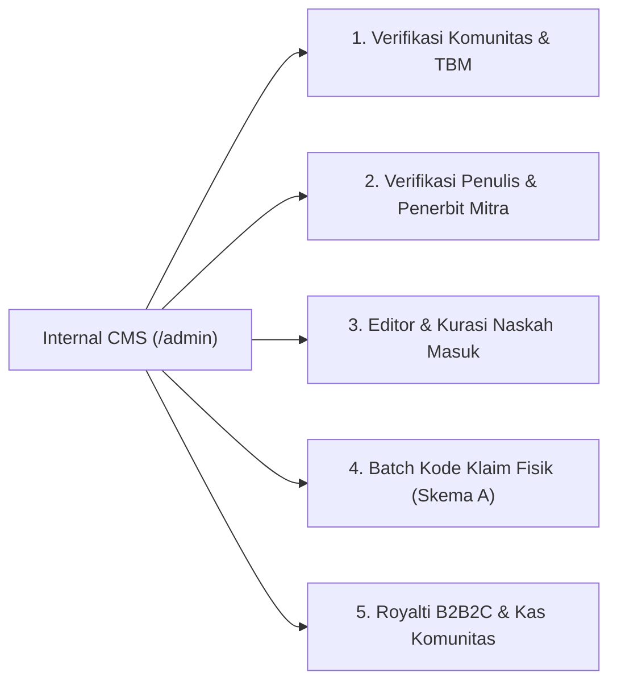
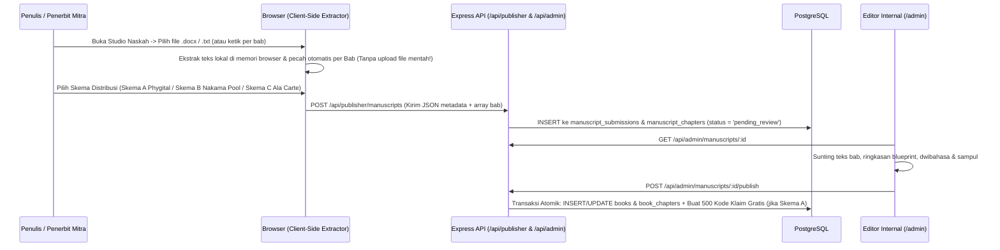
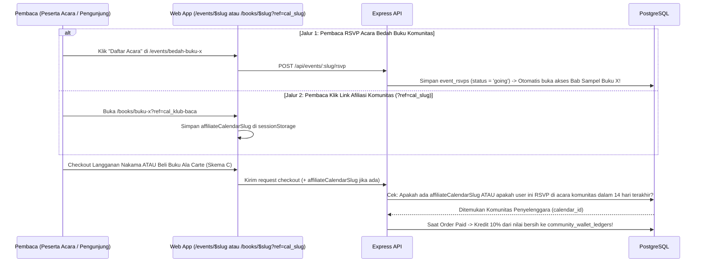

# AnzaBook Social Ecosystem, B2B2C Publisher Aggregator & Internal CMS Implementation Plan

> **For agentic workers:** REQUIRED SUB-SKILL: Use superpowers:subagent-driven-development (recommended) or superpowers:executing-plans to implement this plan task-by-task. Steps use checkbox (`- [ ]`) syntax for tracking.

**Goal:** Membangun ekosistem terpadu AnzaBook yang mencakup perbaikan Agenda Komunitas, Profil Sosial (`bio`, follow, aktivitas baca), `Explore` 4 dimensi, pemisahan Pengurus vs Anggota Komunitas, Studio Pengajuan Naskah (`.docx`/`.txt` client-side extractor), 3 Skema B2B2C Penerbit Mitra (Phygital Claim Code, Nakama Pool 55:45, Ala Carte 75:25), Afiliasi Kas Komunitas 10%, serta Internal Editorial & Curation CMS di `/admin`.

**Architecture:** Monorepo Express 5 + Drizzle PostgreSQL (`apps/api`), TanStack Start SSR + TanStack Query (`apps/web`), dan kontrak tipe/validator Zod terpusat (`packages/shared`). Seluruh pemeriksaan hak baca DRM (`getBookReadAccess`), validasi kecepatan baca (`reading_sessions` WPM guard), dan atribusi komisi afiliasi 10% dieksekusi secara otoritatif di server PostgreSQL tanpa pernah mengekspos file naskah mentah (`.pdf`/`.docx`) di bucket publik.

**Tech Stack:** TypeScript, Express 5, Drizzle ORM, PostgreSQL 17, Better Auth, TanStack Start (React 19, TanStack Router, TanStack Query), Tailwind CSS v4, Zod, Vitest, Playwright.

**Spec:**
* [`docs/superpowers/specs/2026-11-09-b2b2c-publisher-community-monetization.md`](file:///d:/Projekan/AnzaBook/docs/superpowers/specs/2026-11-09-b2b2c-publisher-community-monetization.md)
* [`docs/superpowers/specs/2026-11-09-social-profile-community-author-plan.md`](file:///d:/Projekan/AnzaBook/docs/superpowers/specs/2026-11-09-social-profile-community-author-plan.md)
* [`docs/superpowers/specs/2026-11-09-community-events-plan.md`](file:///d:/Projekan/AnzaBook/docs/superpowers/specs/2026-11-09-community-events-plan.md)

---

## Global Constraints

1. **Batas Body API & Anti-Kebocoran Naskah:** Request body API dibatasi maksimal `100 kB` ([`apps/api/src/middleware/body.ts`](file:///d:/Projekan/AnzaBook/apps/api/src/middleware/body.ts)). Dilarang menyimpan file `.pdf` atau `.docx` utuh di storage publik; ekstraksi `.docx`/`.txt` dilakukan di sisi browser (*client-side*) menjadi teks per bab dan dikirim sebagai JSON terstruktur ke PostgreSQL.
2. **Keamanan & Autentikasi API:** Setiap endpoint mutasi yang memakai cookie wajib melewati `requireAuth` lalu `requireTrustedOrigin`. Endpoint lintas akun di `/api/admin/*` wajib melewati `requirePermission` ([`packages/shared/src/permissions.ts`](file:///d:/Projekan/AnzaBook/packages/shared/src/permissions.ts)).
3. **Standar Anti-Slop & Aksesibilitas:** Wajib mengikuti aturan di `AGENTS.md` (kontras minimal WCAG AA 4.5:1, target sentuh minimal 44x44px, `overflow-x: clip`, tanpa gradien neon/ungu klise, menggunakan token warna tema yang sudah dideklarasikan).
4. **Integritas Migrasi Database:** Selalu jalankan `pnpm db:generate` dan `pnpm db:migrate` untuk penambahan tabel/kolom baru di `apps/api/src/db/schema/`; jangan pernah menulis ulang migrasi yang sudah terkomit.

## Review Focus

1. **Bypass Hak Baca pada Skema A (`print_claim_only`) & Skema C (`alacarte_only`):** Pembaca yang memiliki langganan aktif **Nakama** tidak boleh otomatis terbuka akses penuhnya pada buku berstatus `print_claim_only` (wajib klaim kode fisik) atau `alacarte_only` (wajib beli satuan), kecuali untuk Bab 1 (Sampel) atau bab bahasan acara bagi peserta RSVP aktif.
2. **Kebocoran Acara Privat & Komunitas Belum Terverifikasi:** Endpoint `GET /api/events` hanya boleh mengembalikan acara dengan `visibility = "public"` dan `status = "published"`, serta `POST /api/events` wajib menolak pembuatan acara publik jika `community_calendars.verification_status` masih `"pending"` atau `"rejected"`.
3. **Manipulasi Durasi Baca pada *Nakama Revenue Pool* (55%):** Sesi baca di `reading_sessions` dengan kecepatan tidak wajar (`avg_wpm < 80` atau `avg_wpm > 600` atau `duration_seconds < 120`) harus tetap tersimpan untuk log aktivitas pribadi pembaca, tetapi ditandai `is_valid_for_royalty = false` agar tidak menguras *Creator Pool* penerbit.
4. **Klaim Ganda atau Perhitungan Komisi Afiliasi Ganda (10%):** Webhook pembayaran Midtrans yang dipanggil ulang (*idempotent retry*) untuk `orderId` yang sama tidak boleh menduplikasi baris kredit di `community_wallet_ledgers`.
5. **Kegagalan Parser `.docx` pada Studio Naskah:** Jika penulis mengunggah file `.docx` rusak atau kosong di browser, ekstraktor client-side harus menampilkan pesan error yang jelas dalam bahasa Indonesia tanpa membuat tab browser *crash*.

---

## Bagian 1: Peta Arsitektur — Apa yang Berubah vs Apa yang Bertambah

Bagian ini memetakan secara menyeluruh perubahan pada aplikasi saat ini agar tim pengembang memahami kondisi *Before vs After* di setiap lapisan.

### 1.1 Perubahan & Penambahan di Database (`apps/api/src/db/schema/`)

| Kategori | Nama Tabel | File Skema | Apa yang Berubah / Bertambah |
| :--- | :--- | :--- | :--- |
| **Diubah** | `user` | [`user.ts`](file:///d:/Projekan/AnzaBook/apps/api/src/db/schema/user.ts) | **Tambah kolom:** `bio` (`text`, default `""`), `locationCity` (`varchar(80)`), `socialLinks` (`jsonb`), `authorStatus` (`"none" \| "pending" \| "verified" \| "rejected"`), `authorPenName` (`varchar(160)`). |
| **Diubah** | `books` | [`anzabook.ts`](file:///d:/Projekan/AnzaBook/apps/api/src/db/schema/anzabook.ts) | **Tambah kolom:** `publisherId` (FK $\rightarrow$ `publishers.id`), `authorUserId` (FK $\rightarrow$ `user.id`), `alacartePriceIdr` (`integer`, nullable). **Perluas nilai `digitalPolicy`:** `"free_open"` \| `"print_claim_only"` (Skema A) \| `"sample_only"` (Skema B) \| `"alacarte_only"` (Skema C) \| `"hybrid_nakama_alacarte"`. |
| **Diubah** | `reading_sessions` | [`anzabook.ts`](file:///d:/Projekan/AnzaBook/apps/api/src/db/schema/anzabook.ts) | **Tambah kolom:** `isValidForRoyalty` (`boolean`, default `false`) untuk menyaring sesi baca yang sah masuk perhitungan 55% *Creator Pool* Nakama. |
| **Diubah** | `community_calendar_members` | [`events.ts`](file:///d:/Projekan/AnzaBook/apps/api/src/db/schema/events.ts) | **Perluas nilai `role`:** `"owner"` \| `"admin"` \| `"checkin_staff"` \| `"member"` (memisahkan Pengurus Inti vs Anggota biasa yang klik *Gabung Komunitas*). |
| **Diubah** | `membership_orders` | [`membership.ts`](file:///d:/Projekan/AnzaBook/apps/api/src/db/schema/membership.ts) | **Tambah kolom:** `affiliateCalendarId` (FK $\rightarrow$ `community_calendars.id`), `affiliateEventId` (FK $\rightarrow$ `community_events.id`) untuk pelacakan komisi afiliasi 10% ke Kas Komunitas. |
| **Baru** | `user_follows` | `social.ts` *(Baru)* | Menyimpan relasi *Follow* antar pengguna (`followerUserId`, `followingUserId`, `isSubscribedUpdates`). |
| **Baru** | `author_applications` | `social.ts` *(Baru)* | Menyimpan pengajuan upgrade akun menjadi `Penulis Resmi` (`userId`, `penName`, `bio`, `portfolioUrl`, `claimedBookId`, `status`, `reviewedByUserId`). |
| **Baru** | `publishers` & `publisher_members` | `publishers.ts` *(Baru)* | Menyimpan profil organisasi **Penerbit Mitra B2B2C** (`/p/$slug`, `name`, `ikapiNumber`, `verificationStatus`, `freeClaimCodeQuotaPerBook`, `claimCodeFeeIdr`) beserta daftar pengurusnya (`owner`, `editor`, `finance`). |
| **Baru** | `manuscript_submissions` & `manuscript_chapters` | `publishers.ts` *(Baru)* | Menyimpan pengajuan naskah buku baru dari Studio Naskah (`authorUserId`, `publisherId`, `title`, `synopsis`, `proposedDigitalPolicy`, `proposedAlacartePriceIdr`, `printSimJson`, `status`) dan daftar bab drafnya (`chapterNumber`, `titleId`, `contentId`, `contentEn`, `blueprintContent`). |
| **Baru** | `book_claim_batches` | `publishers.ts` *(Baru)* | Mengelompokkan pencetakan kode klaim fisik Skema A per batch (`bookId`, `publisherId`, `batchName`, `totalCodes`, `unitFeeIdr`, `billingStatus`: `"free_tier"` untuk 500 pertama \| `"unbilled"` \| `"paid"`). |
| **Baru** | `book_purchases` | `publishers.ts` *(Baru)* | Mencatat transaksi pembelian buku satuan Skema C (*Ala Carte*): `userId`, `bookId`, `priceIdr`, `publisherShareIdr` (75%), `affiliateCalendarId`, `affiliateCommissionIdr` (10%), `anzabookNetIdr` (15%–25%), `status`. |
| **Baru** | `community_wallet_ledgers` | `publishers.ts` *(Baru)* | Buku besar **Kas Komunitas** (`calendarId`, `entryType`: `"affiliate_nakama"` \| `"affiliate_book_purchase"` \| `"paid_event_ticket"` \| `"payout_withdrawal"`, `amountIdr`, `sourceOrderId`, `sourceEventId`, `description`). |

---

### 1.2 Apa Saja yang Berubah & Bertambah di Dashboard App (`apps/web/src/`)

Berikut rincian perubahan antarmuka di sisi pengguna (Pembaca, Penulis, Pengurus Komunitas, & Penerbit Mitra):

#### A. Navigasi Utama ([`app-sidebar.tsx`](file:///d:/Projekan/AnzaBook/apps/web/src/features/dashboard/components/app-sidebar.tsx) & [`app.tsx`](file:///d:/Projekan/AnzaBook/apps/web/src/routes/_protected/app.tsx))
* **Berubah:** Tab ke-5 di Sidebar Kiri dan Bottom Navigation Mobile berubah dari `Settings` menjadi **`Profile`** (`/app?tab=profile`).
* **Berubah:** Halaman `Settings` kini diakses lewat tombol **`Pengaturan ⚙️`** di pojok kanan atas halaman `Profile` (`/app?tab=settings` tetap didukung untuk *backward compatibility*).
* **Bertambah:** Jika akun pengguna memiliki role `admin`, muncul tautan cepat **`CMS Internal (/admin)`** di bagian bawah sidebar.

#### B. Halaman `Profile` (`/app?tab=profile` & Rute Publik `/u/$username`)
* **Komponen Baru (`dashboard-profile.tsx` & `routes/u.$username.tsx`):**
  1. **Header Identitas:** Menampilkan Avatar, Nama, `@username`, Kota, teks **`bio`**, serta badge status (`Nakama Member`, `Penulis Resmi ✓`, `Pengurus Komunitas`, `Mitra Penerbit`).
  2. **Bar Statistik Sosial:** Menampilkan jumlah `Followers`, `Following`, `Buku Tamat`, dan `Total Menit Baca`.
  3. **Tombol Aksi Kontekstual:**
     * Jika membuka profil sendiri: Tombol **`Edit Bio & Profil`** + **`Pengaturan ⚙️`**.
     * Jika membuka profil orang lain (`/u/$username`): Tombol **`Ikuti (Follow)`** + toggle **`Langganan Update 🔔`**.
  4. **4 Sub-Tab di Halaman Profile:**
     * **Tab 1 — `Aktivitas & Rak Baca`:** Buku yang *Sedang Dibaca* (lengkap dengan progress bar), buku yang *Tamat*, dan kartu aktivitas baca terbaru.
     * **Tab 2 — `Ulasan & Kutipan`:** Daftar rating bintang, ulasan buku, dan *highlight*/komentar marjinalia publik milik user tersebut.
     * **Tab 3 — `Komunitas & Agenda`:** Daftar komunitas tempat user bergabung (`Pengurus` atau `Anggota`) dan acara yang dihadiri.
     * **Tab 4 — `Studio Penulis & Penerbit`:**
       * Jika belum terverifikasi: Menampilkan kartu ajakan untuk mengajukan **Status Penulis Resmi**, **Komunitas Baru**, atau **Kemitraan Penerbit B2B2C**.
       * Jika sudah terverifikasi sebagai Penulis / Penerbit Mitra: Menampilkan daftar buku karyanya/terbitannya, statistik pembaca & estimasi royalti, tombol **`+ Ajukan Naskah Buku Baru`** (membuka **Studio Pengajuan Naskah** dengan ekstraktor `.docx`/`.txt` client-side), serta tombol **`Kelola Kode Klaim Fisik`** (Skema A).

#### C. Halaman `Explore` 4 Dimensi ([`dashboard-explore.tsx`](file:///d:/Projekan/AnzaBook/apps/web/src/features/dashboard/components/dashboard-explore.tsx))
* **Bertambah:** Switcher 4 Sub-Tab di bawah kolom pencarian utama:
  1. **`Buku`:** Katalog buku dilengkapi filter tambahan berdasarkan **Skema Akses** (*Semua*, *Phygital Klaim Cetak*, *Nakama Pool*, *Ala Carte*, *Gratis*) dan nama **Penerbit**.
  2. **`Penulis`:** Direktori Penulis Resmi AnzaBook (menampilkan avatar, nama pena, `bio`, jumlah buku terbit, jumlah followers, dan tombol **`Ikuti`**).
  3. **`Komunitas`:** Direktori Komunitas & TBM Terverifikasi (filter kota, menampilkan jumlah anggota, jumlah agenda aktif, dan tombol **`Gabung Komunitas`**).
  4. **`Pembaca`:** Direktori sesama pembaca AnzaBook (menampilkan `bio`, buku yang sedang dibaca saat ini, jumlah buku tamat, dan tombol **`Ikuti`**).

#### D. Halaman Komunitas (`/c/$slug` — [`c.$slug.tsx`](file:///d:/Projekan/AnzaBook/apps/web/src/routes/c.$slug.tsx))
* **Bertambah:**
  1. Tombol **`Gabung Komunitas`** (menambahkan user sebagai `member` di `community_calendar_members`) dan **`Bagikan Link Afiliasi Komunitas`** (`?ref=cal_<slug>`).
  2. **Tab `Pengurus & Anggota`:** Bagian atas menampilkan **Pengurus Inti (`Owner` & `Admin`)**; bagian bawah menampilkan **Anggota Komunitas (`Members`)** beserta buku yang sedang mereka baca.
  3. **Tab `Kelola & Kas Komunitas` (Khusus `Owner` & `Admin`):**
     * Menampilkan **Kartu Saldo Kas Komunitas** (total pemasukan dari komisi afiliasi 10% pembelian buku *Ala Carte* & langganan *Nakama* oleh peserta acara/komunitas).
     * Tabel mutasi `community_wallet_ledgers` yang transparan.
     * Pengelolaan daftar pengurus (`tambah co-admin` / `checkin_staff`).

#### E. Halaman Detail Buku (`/books/$slug` — [`books.$slug.tsx`](file:///d:/Projekan/AnzaBook/apps/web/src/routes/books.$slug.tsx)) & Reader
* **Berubah & Bertambah:**
  1. Nama Penerbit (`book.publisherName` / `book.editor`) dan Penulis (`book.author`) menjadi tautan hidup ke `/p/$publisherSlug` dan `/u/$authorUsername`.
  2. Menangkap query `?ref=cal_<slug>` di URL dan menyimpannya di `sessionStorage` selama sesi berlangsung untuk atribusi afiliasi komunitas 10%.
  3. **Panel Aksi Dinamis Sesuai 3 Skema B2B2C:**
     * **Skema A (`print_claim_only`):** Menampilkan tombol **`Baca Sampel Bab 1`**, tombol utama **`🔑 Klaim Kode Buku Cetak Asli`**, dan badge *"Eksklusif Pemilik Buku Cetak Resmi — Tidak Dijual Eceran Digital"*.
     * **Skema B (`sample_only`):** Menampilkan tombol **`Mulai Membaca`**, banner **`Buka Penuh dengan Langganan Nakama`**, serta opsi klaim kode cetak jika tersedia.
     * **Skema C (`alacarte_only`):** Menampilkan tombol **`Baca Sampel Bab 1`** dan tombol utama **`🛒 Beli Akses Digital Selamanya (RpXX.XXX)`** (75% ke Penerbit, 10% ke Kas Komunitas jika lewat link/acara komunitas).

#### F. Halaman Agenda (`/app?tab=events` & `/events/$slug`)
* **Perbaikan 5 Bug Audit & Penambahan Fitur:**
  1. Memperbaiki kontrak API `getLocationSuggestions` agar lokasi terbaru & toko mitra muncul di [`location-picker-popover.tsx`](file:///d:/Projekan/AnzaBook/apps/web/src/features/events/components/location-picker-popover.tsx) + input URL rapat online (`onlineMeetingUrl`).
  2. Menambahkan pemilih buku katalog (`bookId`) di [`create-event-dialog.tsx`](file:///d:/Projekan/AnzaBook/apps/web/src/features/events/components/create-event-dialog.tsx) dan [`edit-event-dialog.tsx`](file:///d:/Projekan/AnzaBook/apps/web/src/features/events/components/edit-event-dialog.tsx).
  3. Menampilkan kotak **Tiket Check-in (`CHK-XXXXXX`)**, tautan rapat online, dan catatan logistik di [`event-detail-view.tsx`](file:///d:/Projekan/AnzaBook/apps/web/src/features/events/components/event-detail-view.tsx) & [`event-detail-drawer.tsx`](file:///d:/Projekan/AnzaBook/apps/web/src/features/events/components/event-detail-drawer.tsx) bagi peserta berstatus `going`.
  4. **Auto-Unlock Sampel Buku Acara:** Peserta berstatus `going` pada acara bedah buku otomatis mendapat hak baca sampel diperluas (Bab 1 & Bab 2) selama periode acara.

---

### 1.3 Apa Saja yang Ada di Internal CMS / Backoffice (`/admin` — [`admin.tsx`](file:///d:/Projekan/AnzaBook/apps/web/src/routes/_protected/admin.tsx))

Saat ini [`apps/web/src/routes/_protected/admin.tsx`](file:///d:/Projekan/AnzaBook/apps/web/src/routes/_protected/admin.tsx) masih berisi template bawaan (`Every account's notes`). Kita merombaknya menjadi **AnzaBook Internal Editorial, Partner & Community CMS** (tetap mempertahankan pengelolaan catatan di sub-tab utilitas agar tes starter lama tidak rusak, atau memperbarui tes secara bersih) dengan **5 Tab Operasional Utama**:

1. **Tab 1 — `Verifikasi Komunitas & Moderasi Acara`:**
   * Daftar pengajuan `community_calendars` berstatus `pending` (menampilkan nama komunitas, kota, jenis entitas, tautan bukti IG/sosmed, dan nama pengaju).
   * Tombol **`Setujui (Verify)`** (mengubah `verification_status = "verified"` sehingga komunitas langsung tampil di `Explore > Komunitas` dan bisa menerbitkan acara publik) atau **`Tolak (Reject)`**.
   * Daftar laporan acara masuk (`event_reports`) dengan aksi tinjau/batalkan acara bermasalah.
2. **Tab 2 — `Verifikasi Penulis & Penerbit Mitra (B2B2C)`:**
   * Daftar pengajuan `author_applications` (`pending`) $\rightarrow$ Klik **`Setujui Penulis Resmi`** (otomatis mengubah `user.authorStatus = "verified"` dan menghubungkan `books.authorUserId`).
   * Daftar pengajuan `publishers` (`pending`) $\rightarrow$ Klik **`Setujui Penerbit Mitra`** (mengaktifkan halaman `/p/$slug` dan kuota gratis 500 kode klaim fisik per buku).
3. **Tab 3 — `Editor & Kurasi Naskah Masuk (Internal Book & Chapter Studio)`:**
   * Daftar naskah masuk dari `manuscript_submissions` (`pending_review`, `in_editing`, `published`, `rejected`).
   * Saat diklik, membuka **Workspace Editor Internal**:
     * Menampilkan metadata buku, hasil simulasi harga cetak rakyat, dan pilihan skema B2B2C (`print_claim_only`, `sample_only`, `alacarte_only`, `free_open`) serta harga `alacartePriceIdr`.
     * **Editor Bab Terstruktur + Impor Cepat `.docx`/`.txt` Lokal:** Redaksi dapat mengedit tiap bab (`titleId`, `contentId`, `contentEn`, `blueprintContent`), atau mengimpor/memperbarui bab langsung dari file `.docx`/`.txt` di komputer redaksi menggunakan *Client-Side Extractor*.
     * Tombol **`Terbitkan ke Katalog AnzaBook`:** Menyalin naskah dan seluruh bab ke tabel produksi `books` & `book_chapters` dalam satu transaksi database atomik!
4. **Tab 4 — `Generator Batch Kode Klaim Fisik (Skema A Phygital)`:**
   * Pilih buku di katalog $\rightarrow$ Pilih Penerbit Mitra $\rightarrow$ Masukkan jumlah kode (misal `500` eksemplar cetakan pertama gratis, atau batch lanjutan Rp2.000/kode).
   * Klik **`Generate Batch Kode Unik`** $\rightarrow$ Sistem membuat 500 kode unik di `book_claim_codes` yang terhubung ke `book_claim_batches`.
   * Tombol **`Unduh CSV Siap Cetak`** (berisi kolom `No`, `Kode Klaim 16 Karakter`, `URL Klaim Langsung`).
5. **Tab 5 — `Monitor Royalti B2B2C (55% Pool & 75% Ala Carte) & Kas Afiliasi Komunitas (10%)`:**
   * Ringkasan **Kantong Royalti Nakama (55% Creator Pool)** bulan berjalan beserta pembagian proporsional per buku/penerbit berdasarkan menit baca valid (`reading_sessions.is_valid_for_royalty = true`).
   * Ringkasan penjualan buku satuan **Ala Carte (75% Penerbit : 25% AnzaBook)**.
   * Ringkasan saldo **Kas Komunitas (`community_wallet_ledgers`)** hasil komisi afiliasi 10% dari seluruh komunitas aktif.

---

## Bagian 2: Alur Detail End-to-End (System Flows)

### 2.1 Flow Pengajuan Naskah (`.docx`/`.txt` Client-Side) hingga Terbit di Katalog

### 2.2 Flow Pembelian & Atribusi Otomatis Komisi Afiliasi 10% ke Kas Komunitas

---

## Bagian 3: Runtutan Task Implementasi (Step-by-Step Verifiable Tasks)

### Task 1: Perbaikan 5 Bug Audit pada Modul `Agenda` & Auto-Unlock Sampel Buku Acara

**Requirement Task:**
1. Menyelaraskan respons `GET /api/events/locations/suggestions` dengan kontrak frontend (`LocationSuggestionDto[]`) agar riwayat lokasi dan toko mitra tampil di popover lokasi.
2. Menambahkan filter `eq(communityEvents.visibility, "public")` pada `listEvents` di [`apps/api/src/services/events.service.ts`](file:///d:/Projekan/AnzaBook/apps/api/src/services/events.service.ts#L344-L432) agar acara `private_link` tidak bocor di direktori publik.
3. Menambahkan pemeriksaan `calendar.verificationStatus === "verified"` (atau `"trusted"`) pada `createEvent` jika `visibility === "public"`.
4. Memperbarui [`books.service.ts`](file:///d:/Projekan/AnzaBook/apps/api/src/services/books.service.ts) agar peserta yang memiliki RSVP aktif (`status === "going"`) pada acara yang membahas suatu buku (`communityEvents.bookId === book.id`) otomatis mendapat akses baca Bab 1 & Bab 2 selama jendela acara.
5. Menampilkan kode tiket `checkinCode` (`CHK-XXXXXX`), `onlineMeetingUrl`, dan `logisticsNotes` pada [`event-detail-view.tsx`](file:///d:/Projekan/AnzaBook/apps/web/src/features/events/components/event-detail-view.tsx) & [`event-detail-drawer.tsx`](file:///d:/Projekan/AnzaBook/apps/web/src/features/events/components/event-detail-drawer.tsx), serta menambahkan pemilih buku katalog (`bookId`) dan input `onlineMeetingUrl` pada [`create-event-dialog.tsx`](file:///d:/Projekan/AnzaBook/apps/web/src/features/events/components/create-event-dialog.tsx).

**Files:**
- Modify: `apps/api/src/services/events.service.ts`
- Modify: `apps/api/src/services/books.service.ts`
- Modify: `apps/web/src/features/events/api.ts`
- Modify: `apps/web/src/features/events/components/create-event-dialog.tsx`
- Modify: `apps/web/src/features/events/components/event-detail-drawer.tsx`
- Modify: `apps/web/src/features/events/components/event-detail-view.tsx`
- Test: `apps/api/src/test/events.test.ts`

**Interfaces:**
- Produces:
  - `getLocationSuggestions(userId: string, query?: string): Promise<LocationSuggestionDto[]>`
  - `hasActiveEventBookSampleAccess(bookId: string, userId: string): Promise<boolean>`

- [ ] **Step 1: Tulis unit/integration test di `apps/api/src/test/events.test.ts` untuk 3 aturan keamanan & lokasi**
  Uji bahwa: (a) acara dengan `visibility: "private_link"` tidak muncul di `GET /api/events`, (b) pembuatan acara publik pada kalender berstatus `"pending"` ditolak dengan `403 CALENDAR_NOT_VERIFIED`, dan (c) `GET /api/events/locations/suggestions` mengembalikan array `LocationSuggestionDto[]`.
- [ ] **Step 2: Jalankan test untuk memverifikasi kegagalan (RED)**
  Run: `pnpm --filter @starter/api test -- events.test.ts`
  Expected: FAIL pada ketiga skenario di atas.
- [ ] **Step 3: Implementasikan perbaikan di `events.service.ts`, `books.service.ts`, dan komponen UI `events`**
  Pastikan `EventDetailDrawer` memanggil `useEventDetail(slug)` sehingga data penuh (`myRsvp.checkinCode`, `onlineMeetingUrl`, `logisticsNotes`) tampil bagi peserta `going`, dan tambahkan dropdown pilih buku katalog di `CreateEventDialog`.
- [ ] **Step 4: Jalankan test untuk memverifikasi kelulusan (GREEN)**
  Run: `pnpm --filter @starter/api test -- events.test.ts`
  Expected: PASS.
- [ ] **Step 5: Commit**
  `git commit -m "fix(events): enforce visibility filter, calendar verification gate, and attendee ticket display"`

---

### Task 2: Skema Database Drizzle & Kontrak Shared untuk Profil Sosial, B2B2C Penerbit Mitra, Studio Naskah, & Kas Komunitas

**Requirement Task:**
1. Memperbarui [`apps/api/src/db/schema/user.ts`](file:///d:/Projekan/AnzaBook/apps/api/src/db/schema/user.ts) (`bio`, `locationCity`, `socialLinks`, `authorStatus`, `authorPenName`).
2. Memperbarui [`apps/api/src/db/schema/anzabook.ts`](file:///d:/Projekan/AnzaBook/apps/api/src/db/schema/anzabook.ts) (`publisherId`, `authorUserId`, `alacartePriceIdr` pada `books`; `isValidForRoyalty` pada `readingSessions`).
3. Memperbarui [`apps/api/src/db/schema/membership.ts`](file:///d:/Projekan/AnzaBook/apps/api/src/db/schema/membership.ts) (`affiliateCalendarId`, `affiliateEventId` pada `membershipOrders`).
4. Membuat [`apps/api/src/db/schema/social.ts`](file:///d:/Projekan/AnzaBook/apps/api/src/db/schema/social.ts) (`userFollows`, `authorApplications`) dan [`apps/api/src/db/schema/publishers.ts`](file:///d:/Projekan/AnzaBook/apps/api/src/db/schema/publishers.ts) (`publishers`, `publisherMembers`, `manuscriptSubmissions`, `manuscriptChapters`, `bookClaimBatches`, `bookPurchases`, `communityWalletLedgers`), lalu mengekspornya di [`apps/api/src/db/schema/index.ts`](file:///d:/Projekan/AnzaBook/apps/api/src/db/schema/index.ts).
5. Menambahkan seluruh DTO dan validator Zod di `packages/shared/src/types/api.ts`, `packages/shared/src/validators/social.ts`, dan `packages/shared/src/validators/publisher.ts`.

**Files:**
- Modify: `apps/api/src/db/schema/user.ts`
- Modify: `apps/api/src/db/schema/anzabook.ts`
- Modify: `apps/api/src/db/schema/events.ts`
- Modify: `apps/api/src/db/schema/membership.ts`
- Create: `apps/api/src/db/schema/social.ts`
- Create: `apps/api/src/db/schema/publishers.ts`
- Modify: `apps/api/src/db/schema/index.ts`
- Create: `packages/shared/src/validators/social.ts`
- Modify: `packages/shared/src/validators/publisher.ts`
- Modify: `packages/shared/src/types/api.ts`
- Modify: `packages/shared/package.json`

**Interfaces:**
- Produces:
  - `DigitalPolicy = "free_open" | "print_claim_only" | "sample_only" | "alacarte_only" | "hybrid_nakama_alacarte"`
  - Tabel Drizzle: `userFollows`, `authorApplications`, `publishers`, `publisherMembers`, `manuscriptSubmissions`, `manuscriptChapters`, `bookClaimBatches`, `bookPurchases`, `communityWalletLedgers`
  - Validator Zod: `updateProfileBioSchema`, `applyAuthorSchema`, `applyPublisherSchema`, `submitManuscriptSchema`, `createClaimBatchSchema`, `purchaseBookAlacarteSchema`

- [ ] **Step 1: Tambahkan definisi tabel di `apps/api/src/db/schema/` dan tipe/validator di `packages/shared/`**
- [ ] **Step 2: Generate dan jalankan migrasi Drizzle**
  Run: `pnpm db:generate && pnpm db:migrate`
  Expected: Migrasi SQL terbentuk di `apps/api/drizzle/` dan sukses diterapkan ke PostgreSQL lokal.
- [ ] **Step 3: Verifikasi kompilasi TypeScript lintas workspace**
  Run: `pnpm --filter @starter/shared typecheck && pnpm --filter @starter/api typecheck`
  Expected: PASS dengan 0 error.
- [ ] **Step 4: Commit**
  `git commit -m "feat(db,shared): add schemas and contracts for social profile, b2b2c publishers, manuscripts, and community wallet"`

---

### Task 3: Mesin Hak Baca DRM 3 Skema B2B2C (`getBookReadAccess`), Pembelian *Ala Carte* (75:25), & Anti-Fraud *Nakama Pool* (55:45)

**Requirement Task:**
1. Memperbarui [`getBookReadAccess`](file:///d:/Projekan/AnzaBook/apps/api/src/services/books.service.ts#L72-L90) agar mendukung matriks 3 Skema B2B2C secara ketat:
   - **`print_claim_only` (Skema A):** Hanya terbuka penuh jika `hasClaimedBook(book.id, userId)` bernilai `true`. Langganan Nakama **tidak** membuka Bab 2+.
   - **`sample_only` (Skema B):** Terbuka penuh jika `hasClaimedBook` ATAU `getActiveMembership(userId)` aktif.
   - **`alacarte_only` (Skema C):** Terbuka penuh jika `hasClaimedBook` ATAU user telah membeli buku tersebut di tabel `book_purchases` (`status = "paid"`). Langganan Nakama **tidak** membuka Bab 2+.
   - **`hybrid_nakama_alacarte`:** Terbuka penuh jika klaim fisik, member Nakama aktif, atau sudah beli *Ala Carte*.
2. Menambahkan *Anti-Fraud WPM Guard* pada pembuatan sesi baca di [`reading.service.ts`](file:///d:/Projekan/AnzaBook/apps/api/src/services/reading.service.ts) / `community.service.ts`: sesi baca ditandai `isValidForRoyalty = true` hanya jika user memiliki langganan Nakama aktif (atau buku Skema B), `durationSeconds` antara `120` dan `3600`, serta `avgWpm` antara `80` dan `600`.
3. Membuat endpoint pembelian buku *Ala Carte* (`POST /api/books/:slug/purchase`) dengan pembagian otomatis **75% Penerbit Mitra**, **10% Komisi Afiliasi Komunitas** (jika ada atribusi link `?ref=cal_<slug>` atau user RSVP acara komunitas dalam 14 hari terakhir), dan sisanya untuk AnzaBook.
4. Memperbarui konfirmasi pembayaran Nakama di [`membership.service.ts`](file:///d:/Projekan/AnzaBook/apps/api/src/services/membership.service.ts) agar mengkreditkan **10% komisi afiliasi** ke `community_wallet_ledgers` secara idempoten jika pesanan terhubung ke komunitas.

**Files:**
- Modify: `apps/api/src/services/books.service.ts`
- Modify: `apps/api/src/services/community.service.ts`
- Modify: `apps/api/src/services/membership.service.ts`
- Modify: `apps/api/src/routes/books.routes.ts`
- Test: `apps/api/src/test/b2b2c-monetization.test.ts`

**Interfaces:**
- Produces:
  - `purchaseBookAlacarte(userId: string, slug: string, affiliateCalendarSlug?: string): Promise<BookPurchaseDto>`
  - `resolveCommunityAffiliateAttribution(userId: string, explicitCalendarSlug?: string, bookId?: string): Promise<{ calendarId: string; eventId: string | null } | null>`

- [ ] **Step 1: Tulis integration test di `apps/api/src/test/b2b2c-monetization.test.ts`**
  Uji 5 skenario kritis:
  1. Member Nakama aktif mencoba membaca Bab 2 buku `print_claim_only` tanpa kode klaim $\rightarrow$ hanya mendapat pratinjau terkunci (`hasFullAccess: false`).
  2. Pembaca menukarkan kode klaim pada buku `print_claim_only` $\rightarrow$ `hasFullAccess: true`.
  3. Pembaca membeli buku `alacarte_only` seharga Rp45.000 melalui link afiliasi komunitas $\rightarrow$ tercatat `publisherShareIdr = 33750` (75%), `affiliateCommissionIdr = 4500` (10% di `community_wallet_ledgers`), `anzabookNetIdr = 6750` (15%), dan `hasFullAccess: true`.
  4. Peserta yang RSVP acara bedah buku sebuah komunitas membeli langganan Nakama dalam 14 hari tanpa parameter `?ref` $\rightarrow$ atribusi otomatis memberikan komisi 10% ke `community_wallet_ledgers` komunitas tersebut (dan tidak terduplikasi jika fungsi dipanggil dua kali).
  5. Sesi baca dengan `avgWpm = 1200` (anomali bot) tetap tersimpan tetapi `isValidForRoyalty === false`.
- [ ] **Step 2: Jalankan test untuk memverifikasi kegagalan (RED)**
  Run: `pnpm --filter @starter/api test -- b2b2c-monetization.test.ts`
  Expected: FAIL.
- [ ] **Step 3: Implementasikan logika DRM 3 skema, WPM guard, pembelian Ala Carte, dan atribusi afiliasi 10%**
- [ ] **Step 4: Jalankan test untuk memverifikasi kelulusan (GREEN)**
  Run: `pnpm --filter @starter/api test -- b2b2c-monetization.test.ts`
  Expected: PASS.
- [ ] **Step 5: Commit**
  `git commit -m "feat(api): implement 3 B2B2C DRM schemes, WPM anti-fraud guard, and 10% community affiliate ledger"`

---

### Task 4: API Profil Sosial (`bio`, Follow, Aktivitas), Direktori `Explore` 4 Dimensi, Keanggotaan Komunitas, & Studio Naskah

**Requirement Task:**
1. Membuat service & route untuk Profil Sosial (`GET /api/social/users/:username`, `PATCH /api/social/profile` untuk update `bio`, kota, dan nama pena, `POST /api/social/users/:userId/follow`, `DELETE /api/social/users/:userId/follow`).
2. Membuat endpoint direktori pencarian untuk `Explore` 4 Dimensi (`GET /api/social/explore/authors`, `GET /api/social/explore/readers`, `GET /api/events/calendars` untuk komunitas terverifikasi, dan `GET /api/publisher/list` untuk penerbit mitra).
3. Menambahkan endpoint **Gabung Komunitas** (`POST /api/events/calendars/:slug/join` dan `DELETE /api/events/calendars/:slug/leave`) yang mendaftarkan user sebagai `role = "member"` di `community_calendar_members`, serta endpoint `GET /api/events/calendars/:slug/wallet` (khusus `owner`/`admin` komunitas untuk melihat saldo & mutasi Kas Komunitas).
4. Membuat endpoint pengajuan **Penulis Resmi** (`POST /api/social/author-applications`), **Penerbit Mitra** (`POST /api/publisher/apply`), dan **Studio Pengajuan Naskah** (`POST /api/publisher/manuscripts` & `GET /api/publisher/manuscripts/mine`).

**Files:**
- Create: `apps/api/src/services/social.service.ts`
- Create: `apps/api/src/services/publisher.service.ts`
- Create: `apps/api/src/routes/social.routes.ts`
- Modify: `apps/api/src/routes/publisher.routes.ts`
- Modify: `apps/api/src/routes/events.routes.ts`
- Modify: `apps/api/src/routes/index.ts`
- Test: `apps/api/src/test/social-and-manuscripts.test.ts`

**Interfaces:**
- Produces:
  - `GET /api/social/me` & `PATCH /api/social/me`
  - `GET /api/social/users/:username`
  - `POST /api/social/users/:id/follow`
  - `GET /api/social/explore/authors` & `GET /api/social/explore/readers`
  - `POST /api/events/calendars/:slug/join` & `GET /api/events/calendars/:slug/wallet`
  - `POST /api/publisher/apply` & `POST /api/publisher/manuscripts`

- [ ] **Step 1: Tulis integration test di `apps/api/src/test/social-and-manuscripts.test.ts`**
  Uji update `bio`, follow/unfollow antar user, join komunitas sebagai `member` (dan pastikan `member` biasa tidak bisa membuat acara atau mengintip saldo kas komunitas), pengajuan aplikasi penulis, serta pengiriman draf naskah multi-bab ke `manuscript_submissions`.
- [ ] **Step 2: Jalankan test untuk memverifikasi kegagalan (RED)**
  Run: `pnpm --filter @starter/api test -- social-and-manuscripts.test.ts`
  Expected: FAIL.
- [ ] **Step 3: Implementasikan `social.service.ts`, `publisher.service.ts`, dan daftarkan router di `routes/index.ts`**
- [ ] **Step 4: Jalankan test untuk memverifikasi kelulusan (GREEN)**
  Run: `pnpm --filter @starter/api test -- social-and-manuscripts.test.ts`
  Expected: PASS.
- [ ] **Step 5: Commit**
  `git commit -m "feat(api): add social profile, 4D explore, community membership, wallet, and manuscript submission endpoints"`

---

### Task 5: API Internal CMS (`/api/admin/*`) — Verifikasi Komunitas/Penulis/Penerbit, Editor Naskah ke Katalog, & Generator Batch Kode Klaim

**Requirement Task:**
1. Memperluas [`apps/api/src/routes/admin.routes.ts`](file:///d:/Projekan/AnzaBook/apps/api/src/routes/admin.routes.ts) dan membuat `apps/api/src/services/admin-cms.service.ts` dengan penjagaan `requirePermission`:
   - `GET /api/admin/overview` (ringkasan antrean verifikasi, total 55% *Creator Pool* Nakama bulan ini, total penjualan *Ala Carte*, dan total komisi afiliasi komunitas).
   - `GET /api/admin/calendars` & `PATCH /api/admin/calendars/:id/verify` (Approve/Reject pengajuan komunitas).
   - `GET /api/admin/author-applications` & `PATCH /api/admin/author-applications/:id/review` (Approve/Reject penulis resmi + tautkan ke `books.authorUserId`).
   - `GET /api/admin/publishers` & `PATCH /api/admin/publishers/:id/verify` (Approve/Reject Penerbit Mitra B2B2C).
   - `GET /api/admin/manuscripts`, `GET /api/admin/manuscripts/:id`, `PATCH /api/admin/manuscripts/:id`, dan **`POST /api/admin/manuscripts/:id/publish`** (menyunting bab draf di Editor Internal lalu menerbitkannya secara atomik menjadi baris aktif di `books` dan `book_chapters`).
   - `POST /api/admin/claim-batches` & `GET /api/admin/claim-batches/:id/codes` (men-generate batch kode klaim fisik Skema A — 500 pertama gratis/`free_tier`, selanjutnya berbayar — beserta daftar kode untuk ekspor CSV).

**Files:**
- Create: `apps/api/src/services/admin-cms.service.ts`
- Modify: `apps/api/src/routes/admin.routes.ts`
- Test: `apps/api/src/test/admin-cms.test.ts`

**Interfaces:**
- Produces:
  - `publishManuscriptToCatalogAny(manuscriptId: string, overrides?: Partial<PublishManuscriptInput>): Promise<{ bookId: string; slug: string; generatedClaimCodesCount: number }>`
  - `generateBookClaimBatchAny(input: CreateClaimBatchInput): Promise<{ batchId: string; codes: string[]; billingStatus: "free_tier" | "unbilled" }>`

- [ ] **Step 1: Tulis integration test di `apps/api/src/test/admin-cms.test.ts`**
  Uji bahwa: (a) user non-admin ditolak (`403`), (b) admin dapat menyetujui komunitas (`pending` $\rightarrow$ `verified`), (c) admin dapat menyunting draf naskah di `manuscript_submissions` lalu memanggil `/publish` sehingga buku langsung muncul di katalog `GET /api/books` lengkap dengan bab-babnya, dan (d) pembuatan batch 500 kode klaim pertama mendapat `billingStatus: "free_tier"` sedangkan batch kedua mendapat `billingStatus: "unbilled"` dengan `unitFeeIdr: 2000`.
- [ ] **Step 2: Jalankan test untuk memverifikasi kegagalan (RED)**
  Run: `pnpm --filter @starter/api test -- admin-cms.test.ts`
  Expected: FAIL.
- [ ] **Step 3: Implementasikan `admin-cms.service.ts` dan endpoint di `admin.routes.ts`**
- [ ] **Step 4: Jalankan test untuk memverifikasi kelulusan (GREEN)**
  Run: `pnpm --filter @starter/api test -- admin-cms.test.ts`
  Expected: PASS.
- [ ] **Step 5: Commit**
  `git commit -m "feat(admin-api): add internal CMS endpoints for curating communities, authors, publishers, manuscripts, and claim code batches"`

---

### Task 6: Frontend Navigasi `Profile`, Halaman Profil Sosial (`/app?tab=profile` & `/u/$username`), & Studio Pengajuan Naskah (`.docx`/`.txt` Extractor)

**Requirement Task:**
1. Mengubah item navigasi ke-5 di [`app-sidebar.tsx`](file:///d:/Projekan/AnzaBook/apps/web/src/features/dashboard/components/app-sidebar.tsx) dan [`app.tsx`](file:///d:/Projekan/AnzaBook/apps/web/src/routes/_protected/app.tsx) menjadi **`Profile`** (`tab: "profile"`), dan menaruh tombol **`Pengaturan ⚙️`** di dalam header `Profile` (yang membuka [`dashboard-settings.tsx`](file:///d:/Projekan/AnzaBook/apps/web/src/features/dashboard/components/dashboard-settings.tsx)).
2. Membangun komponen **`dashboard-profile.tsx`** dan rute publik **`/u/$username`** (`apps/web/src/routes/u.$username.tsx`) yang menampilkan:
   - Header profil (`bio`, kota, badge `Penulis Resmi`, `Pengurus/Anggota Komunitas`, `Followers`/`Following`, tombol `Edit Profil` atau `Ikuti`).
   - 4 Sub-Tab: `Aktivitas & Bacaan`, `Ulasan & Kutipan`, `Komunitas & Agenda`, serta `Studio Penulis & Penerbit`.
3. Membangun **`manuscript-studio-dialog.tsx`** dengan fitur **Client-Side `.docx` / `.txt` Chapter Extractor**:
   - Mendukung pengetikan langsung per bab ATAU memilih file `.docx`/`.txt` lokal di browser (memakai parser ZIP/XML ringan untuk `word/document.xml` pada `.docx` dan pemisah heading `BAB ` / `Chapter ` pada `.txt` secara murni di browser tanpa upload file mentah ke server).
   - Mendukung pemilihan skema B2B2C (`Skema A: Phygital Bundling`, `Skema B: Nakama Pool 55:45`, `Skema C: Beli Putus Ala Carte 75:25`) dan simulasi cetak rakyat.

**Files:**
- Create: `apps/web/src/features/social/api.ts`
- Create: `apps/web/src/features/social/queries.ts`
- Create: `apps/web/src/features/social/hooks.ts`
- Create: `apps/web/src/features/social/utils/client-manuscript-extractor.ts`
- Create: `apps/web/src/features/social/components/manuscript-studio-dialog.tsx`
- Create: `apps/web/src/features/dashboard/components/dashboard-profile.tsx`
- Create: `apps/web/src/routes/u.$username.tsx`
- Modify: `apps/web/src/features/dashboard/components/app-sidebar.tsx`
- Modify: `apps/web/src/ features/dashboard/components/dashboard-settings.tsx`
- Modify: `apps/web/src/routes/_protected/app.tsx`

- [ ] **Step 1: Buat `client-manuscript-extractor.ts` beserta unit test untuk ekstraksi teks `.txt` dan `.docx` menjadi array bab**
- [ ] **Step 2: Buat `api.ts`, `queries.ts`, `hooks.ts` di `apps/web/src/features/social/`**
- [ ] **Step 3: Bangun `dashboard-profile.tsx`, `manuscript-studio-dialog.tsx`, dan rute `/u/$username`, lalu hubungkan ke `app-sidebar.tsx` & `app.tsx`**
- [ ] **Step 4: Verifikasi typecheck pada `apps/web`**
  Run: `pnpm --filter @starter/web typecheck`
  Expected: PASS.
- [ ] **Step 5: Commit**
  `git commit -m "feat(web): add social profile tab, public /u/$username page, and client-side manuscript submission studio"`

---

### Task 7: Frontend `Explore` 4 Dimensi, Halaman Komunitas (`/c/$slug` + Kas Afiliasi 10%), Halaman Penerbit Mitra (`/p/$slug`), & Detail Buku B2B2C (`/books/$slug`)

**Requirement Task:**
1. Memperbarui [`dashboard-explore.tsx`](file:///d:/Projekan/AnzaBook/apps/web/src/features/dashboard/components/dashboard-explore.tsx) dengan 4 sub-tab: **`Buku`** (dengan filter Skema Akses B2B2C), **`Penulis`**, **`Komunitas`**, dan **`Pembaca`** (lengkap dengan aksi `Ikuti` dan `Gabung Komunitas`).
2. Memperbarui [`c.$slug.tsx`](file:///d:/Projekan/AnzaBook/apps/web/src/routes/c.$slug.tsx) agar memiliki:
   - Tombol **`Gabung Komunitas`** (menjadi `Member`) dan **`Bagikan Link Afiliasi 10%`**.
   - Tab **`Pengurus & Anggota`** (memisahkan `Owner/Admin` vs `Members`).
   - Tab **`Kelola & Kas Komunitas`** (khusus `Owner/Admin` — menampilkan saldo Kas Komunitas dari komisi afiliasi 10%, tabel riwayat mutasi `community_wallet_ledgers`, dan pengelolaan pengurus).
3. Membuat rute publik **Halaman Penerbit Mitra (`/p/$slug` — `apps/web/src/routes/p.$slug.tsx`)** yang menampilkan profil penerbit, badge verifikasi IKAPI/Mitra, dan daftar buku mereka.
4. Memperbarui [`books.$slug.tsx`](file:///d:/Projekan/AnzaBook/apps/web/src/routes/books.$slug.tsx) agar menampilkan tombol aksi yang sesuai dengan Skema A (`print_claim_only`), Skema B (`sample_only`), atau Skema C (`alacarte_only` — tombol **Beli Akses Digital Selamanya**), serta menyimpan parameter `?ref=cal_<slug>` untuk atribusi komisi komunitas 10%.

**Files:**
- Modify: `apps/web/src/features/dashboard/components/dashboard-explore.tsx`
- Modify: `apps/web/src/routes/c.$slug.tsx`
- Create: `apps/web/src/routes/p.$slug.tsx`
- Modify: `apps/web/src/routes/books.$slug.tsx`

- [ ] **Step 1: Perbarui `dashboard-explore.tsx` dengan switcher 4 sub-tab (`Buku`, `Penulis`, `Komunitas`, `Pembaca`)**
- [ ] **Step 2: Perbarui `c.$slug.tsx` dengan fitur Gabung Komunitas, tab Pengurus vs Anggota, dan tab Kas & Afiliasi Komunitas (10%)**
- [ ] **Step 3: Buat halaman Penerbit Mitra `p.$slug.tsx` dan perbarui `books.$slug.tsx` untuk mendukung 3 skema tombol B2B2C & pelacakan `?ref=`**
- [ ] **Step 4: Jalankan typecheck dan build web**
  Run: `pnpm --filter @starter/web typecheck`
  Expected: PASS.
- [ ] **Step 5: Commit**
  `git commit -m "feat(web): implement 4D explore, community membership & 10% affiliate wallet UI, publisher page, and B2B2C book actions"`

---

### Task 8: Frontend Internal Editorial & Curation CMS (`/admin` — [`admin.tsx`](file:///d:/Projekan/AnzaBook/apps/web/src/routes/_protected/admin.tsx))

**Requirement Task:**
1. Merombak [`apps/web/src/routes/_protected/admin.tsx`](file:///d:/Projekan/AnzaBook/apps/web/src/routes/_protected/admin.tsx) dan membangun modul `apps/web/src/features/admin/` menjadi **Internal Editorial & Curation CMS** dengan 5 tab utama:
   - **Tab 1: `Verifikasi Komunitas & Moderasi Acara`** (Approve/Reject komunitas `pending` & tinjau laporan acara).
   - **Tab 2: `Verifikasi Penulis & Penerbit Mitra`** (Approve/Reject aplikasi penulis & penerbit B2B2C).
   - **Tab 3: `Editor & Kurasi Naskah Masuk`** (Buka kiriman naskah dari `manuscript_submissions`, sunting bab atau impor dari `.docx`/`.txt` lokal, atur skema B2B2C, lalu klik **`Terbitkan ke Katalog`**).
   - **Tab 4: `Generator Batch Kode Klaim Fisik (Skema A)`** (Generate 500 kode gratis pertama atau batch berbayar + tombol **Unduh CSV Siap Cetak**).
   - **Tab 5: `Monitor Royalti B2B2C & Kas Komunitas`** (Tampilkan metrik 55% *Creator Pool* Nakama, 75% *Ala Carte*, dan 10% Komisi Afiliasi Komunitas).

**Files:**
- Modify: `apps/web/src/features/admin/api.ts`
- Modify: `apps/web/src/features/admin/queries.ts`
- Modify: `apps/web/src/features/admin/hooks.ts`
- Create: `apps/web/src/features/admin/components/admin-cms-dashboard.tsx`
- Modify: `apps/web/src/routes/_protected/admin.tsx`

- [ ] **Step 1: Tambahkan fungsi API, query options, dan mutation hooks di `apps/web/src/features/admin/`**
- [ ] **Step 2: Bangun `admin-cms-dashboard.tsx` dengan 5 tab operasional lengkap beserta fitur ekspor CSV kode klaim dan editor bab**
- [ ] **Step 3: Hubungkan ke `apps/web/src/routes/_protected/admin.tsx` dan jalankan pemeriksaan penuh (`pnpm check` & `pnpm build`)**
  Run: `pnpm check && pnpm build`
  Expected: Seluruh lint, typecheck, unit/integration test API, dan build produksi lulus 100%.
- [ ] **Step 4: Commit**
  `git commit -m "feat(admin-cms): build full internal editorial, partner verification, manuscript editor, and claim code batch CMS"`
