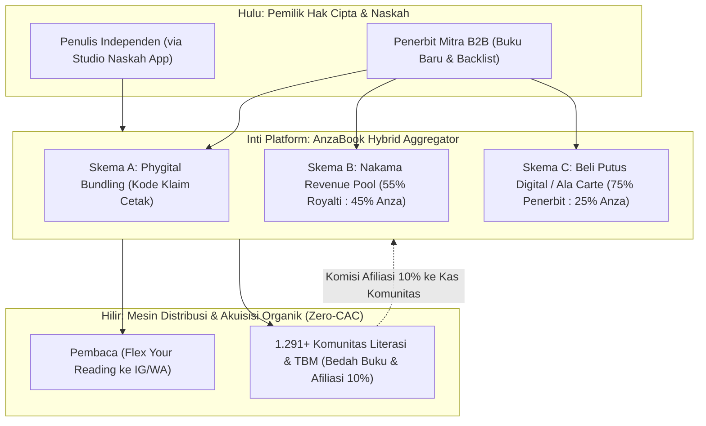
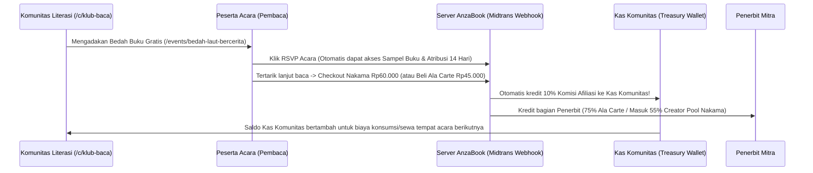

# Blueprint Bisnis & Arsitektur Teknis: AnzaBook sebagai Hybrid Aggregator (B2B2C Penerbit Mitra & Mesin Afiliasi Komunitas)

**Tanggal:** 9 November 2026  
**Status:** Dokumen Spesifikasi Resmi (Terkunci)  
**Dokumen Terkait:**
* [`PRD_AnzaBook.md`](file:///d:/Projekan/AnzaBook/PRD_AnzaBook.md)
* [`2026-11-09-social-profile-community-author-plan.md`](file:///d:/Projekan/AnzaBook/docs/superpowers/specs/2026-11-09-social-profile-community-author-plan.md)
* [`2026-11-09-community-events-plan.md`](file:///d:/Projekan/AnzaBook/docs/superpowers/specs/2026-11-09-community-events-plan.md)

---

## 1. Reposisi Strategis: "Mitra Distribusi & Teknologi, Bukan Pesaing Penerbit"

Jika AnzaBook hanya berdiri sebagai satu penerbit tunggal, pertumbuhan katalog akan lambat dan penerbit lain di Indonesia akan menganggap AnzaBook sebagai kompetitor. Sebaliknya, jika AnzaBook memosisikan diri sebagai **Hybrid Publisher Aggregator (B2B2C)**:
1. **Jalur Redaksi Internal (In-House / Indie Author):** Penulis independen yang belum punya penerbit bisa mengajukan naskah langsung lewat *Studio Pengajuan Naskah* di AnzaBook untuk diterbitkan di bawah lini cetak rakyat & pustaka digital AnzaBook.
2. **Jalur Penerbit Mitra (B2B2C Partner Publishers):** Penerbit buku di Indonesia (baik penerbit mayor maupun independen) dapat membuka **Akun Resmi Penerbit Mitra (`/p/$slug`)**, memindahkan katalog mereka ke infrastruktur DRM AnzaBook, dan **memilih sendiri model monetisasi per judul buku** tanpa takut penjualan buku fisik mereka mati.

---

## 2. Tiga Pintu Kerja Sama Penerbit Mitra (Bebas Pilih per Judul)

Masalah terbesar penerbit buku di Indonesia ada dua:
1. **Takut e-book membunuh penjualan buku cetak baru mereka**, sementara buku cetaknya dibajak secara brutal di lokapasar (Shopee/Tokopedia) dan PDF liar (75% responden survei IKAPI).
2. **Ribuan stok judul lama (*backlist* usia 1–3 tahun) mati di gudang** karena sudah diretur dari rak toko buku fisik; mau cetak ulang mahal, didiamkan menghasilkan Rp0.

AnzaBook menyelesaikan kedua masalah tersebut dengan memberikan **3 skema distribusi per judul** yang dikontrol langsung di level database (`books.distribution_scheme` & `books.digital_policy`):

### Skema A — "Phygital Bundling" (Kode Klaim Fisik)
* **Peruntukan:** Buku Baru Rilis (*New Release*) / *Best-Seller* yang masih aktif dijual cetak di toko buku atau lokapasar resmi penerbit.
* **Masalah Penerbit:** Penerbit tidak mau menaruh buku barunya di layanan langganan digital (takut orang batal beli buku cetak), tapi buku cetaknya dipalsukan pembajak.
* **Tawaran AnzaBook:**
  > *"Buku baru kalian tidak perlu dijual e-book eceran dan tidak dibuka lewat langganan Nakama. Tetap jual buku fisiknya. Cukup selipkan Kode Klaim AnzaBook (stiker gores / kartu segel 16 karakter) di dalam buku cetak asli kalian."*
* **Nilai Tambah bagi Penerbit & Pembaca:**
  1. **Segel Keaslian Anti-Bajakan:** Pembeli buku bajakan di lokapasar tidak akan mendapatkan kode klaim valid. Hanya pembeli buku cetak asli yang bisa mengklaim akses digital di AnzaBook.
  2. **Pengalaman Baca "Phygital":** Saat sedang di perjalanan tanpa membawa buku fisik, pemilik buku tetap bisa lanjut membaca di web reader AnzaBook, memakai stabilo *highlight*, berdiskusi per paragraf (*marginalia*) dengan sesama pemilik buku asli, dan membagikan kartu **Flex Your Reading** ke Instagram Stories (yang otomatis menjadi iklan organik gratis bagi buku penerbit tersebut!).
  3. **Sampel Bab 1 sebagai Pancingan Beli Cetak:** Pengunjung umum di AnzaBook hanya bisa membaca Bab 1 (Sampel). Saat masuk Bab 2, layar menampilkan: *"Buku ini khusus pemilik edisi cetak resmi Penerbit [Nama Penerbit]. Masukkan Kode Klaim dari buku fisik Anda atau beli edisi cetak asli di toko mitra."*
* **Model Monetisasi AnzaBook (B2B SaaS Fee):**
  * **Gratis 500 kode pertama per judul** (sebagai *Zero-CAC User Acquisition* untuk menarik pembeli buku cetak penerbit menjadi pengguna aktif AnzaBook).
  * Untuk batch berikutnya: Penerbit membayar biaya pencetakan/aktivasi kode yang sangat terjangkau, yaitu **Rp1.500 – Rp3.000 per kode yang diklaim aktif** (atau beli kuota batch di muka).

---

### Skema B — "Nakama Revenue Pool" (Model Spotify / Kindle Unlimited)
* **Peruntukan:** Buku Lama (*Backlist* terbitan 1–3 tahun lalu) yang sudah turun dari rak Gramedia/toko buku fisik.
* **Masalah Penerbit:** Mau cetak ulang terbentur MOQ percetakan yang mahal, tapi kalau didiamkan di gudang tidak menghasilkan arus kas.
* **Tawaran AnzaBook:** Masukkan judul-judul *backlist* tersebut ke dalam katalog langganan **Nakama**.
* **Mekanisme Bagi Hasil (*Fair-Share User-Centric / Pro-Rata Pool*):**
  1. Setiap bulan, dari total pendapatan bersih langganan **Nakama** yang masuk (setelah dikurangi pajak dan biaya transaksi QRIS/Midtrans), sistem membagi:
     * **55% masuk ke Kantong Royalti (*Creator Pool*)** untuk dibagikan ke Penerbit/Penulis.
     * **45% untuk AnzaBook** (biaya infrastruktur server, DRM, bandwidth, operasional, dan komisi afiliasi komunitas).
  2. Uang di dalam *Creator Pool* (55%) didistribusikan secara proporsional berdasarkan **Durasi Baca Valid & Bab Terselesaikan** yang sudah tercatat di tabel [`reading_sessions`](file:///d:/Projekan/AnzaBook/apps/api/src/db/schema/anzabook.ts#L220-L245).
  3. **Rumus Perhitungan Royalti Bulanan per Penerbit:**
     $$\text{Royalti Penerbit } A = \text{Total Creator Pool Bulan Ini} \times \frac{\text{Total Menit Baca Valid Buku Penerbit } A}{\text{Total Menit Baca Valid Seluruh Buku Nakama}}$$
     * *Contoh Konkret:* Jika pada bulan November total *Creator Pool* (55%) adalah Rp100.000.000, dan buku-buku *backlist* milik Penerbit A menyumbang **10%** dari total waktu baca valid seluruh member Nakama pada bulan itu, maka Penerbit A otomatis menerima **Rp10.000.000** di dasbor royalti mereka.

---

### Skema C — Beli Putus Digital (*Ala Carte*)
* **Peruntukan:** Buku Eksklusif, Buku Referensi/Akademik, atau Edisi Khusus yang penerbitnya hanya ingin menjual akses baca digital secara satuan per judul (misal **Rp45.000/judul**) di luar paket langganan Nakama.
* **Tawaran AnzaBook:** Pembaca membeli akses permanen untuk 1 judul buku tersebut melalui checkout QRIS/Midtrans di halaman `/books/$slug`, dan membacanya di dalam web reader ber-DRM AnzaBook (bukan mengunduh file PDF/EPUB mentah yang bisa disebarkan di grup Telegram).
* **Mekanisme Bagi Hasil:**
  * **75% untuk Penerbit Mitra : 25% untuk AnzaBook** (dari harga bersih setelah pajak/biaya payment gateway).
  * **Kenapa Sangat Menarik bagi Penerbit?** Toko buku fisik tradisional memotong rabat distribusi **40% – 50%** (ditambah pembayaran mundur/konsinyasi 3–6 bulan), dan platform global memotong **30% – 48%**. Di AnzaBook, penerbit memegang **75%**, bebas biaya cetak/gudang, dan 100% terlindungi DRM server-side.

---

### Ringkasan Matriks Hak Baca di Server (`getBookReadAccess`)

Saat ini di [`apps/api/src/services/books.service.ts`](file:///d:/Projekan/AnzaBook/apps/api/src/services/books.service.ts#L72-L90), fungsi `getBookReadAccess` memeriksa `digitalPolicy`. Dengan 3 skema B2B2C di atas, matriks keputusan server menjadi sangat tegas dan transparan:

| Skema Buku (`digitalPolicy`) | Bab 1 (Sampel) | Peserta RSVP Acara Bedah Buku Ini | Member Langganan **Nakama** | Pembeli Satuan (*Ala Carte*) | Pemilik **Kode Klaim Fisik** |
| :--- | :---: | :---: | :---: | :---: | :---: |
| **`free_open`** (Buletin / Domain Publik) | ✅ Terbuka | ✅ Terbuka Penuh | ✅ Terbuka Penuh | ✅ Terbuka Penuh | ✅ Terbuka Penuh |
| **Skema A: `print_claim_only`** *(Phygital Bundling)* | ✅ Terbuka | ✅ Sampel + Bab Bahasan Acara | ❌ **Terkunci** *(Wajib Kode Cetak)* | ❌ Tidak Dijual Eceran | ✅ **Terbuka Penuh Selamanya** |
| **Skema B: `sample_only`** *(Nakama Revenue Pool)* | ✅ Terbuka | ✅ Sampel + Bab Bahasan Acara | ✅ **Terbuka Penuh** *(Masuk Hitungan Pool 55%)* | ✅ Terbuka Penuh *(Jika Opsi Beli Aktif)* | ✅ **Terbuka Penuh Selamanya** |
| **Skema C: `alacarte_only`** *(Beli Putus Digital)* | ✅ Terbuka | ✅ Sampel + Bab Bahasan Acara | ❌ **Terkunci** *(Wajib Beli Satuan)* | ✅ **Terbuka Penuh Selamanya** | ✅ **Terbuka Penuh Selamanya** |

---

## 3. Mesin Komunitas & Penggerak Literasi (Zero-CAC Acquisition & Kas Komunitas)

Sesuai data Badan Bahasa di [`PRD_AnzaBook.md` Bagian 3.3](file:///d:/Projekan/AnzaBook/PRD_AnzaBook.md#L83-L89), terdapat **1.291 komunitas literasi** dan **2.388 TBM** di Indonesia yang mayoritas membiayai kegiatannya secara mandiri dari kantong pengurus.

**Prinsip Utama AnzaBook:** Jangan memeras uang dari komunitas di awal. Jadikan komunitas sebagai **mesin akuisisi pembaca organik (*Zero-CAC Acquisition*)** dan berikan mereka jalur resmi untuk mengisi **Kas Komunitas** lewat kegiatan bedah buku!

### 3.1 Tiga Pilar Ekonomi Komunitas di AnzaBook

#### 1. Acara Gratis (Bedah Buku / Baca Bareng / Silent Reading) — **100% Gratis + Auto-Unlock Sampel**
* Komunitas yang terverifikasi mendapatkan:
  * Halaman profil organisasi resmi (`/c/$slug`) dengan daftar Pengurus & Anggota.
  * Halaman publikasi agenda (`/events/$slug`), sistem RSVP berkuota, kode tiket check-in (`CHK-XXXXXX`), dan ekspor daftar hadir.
* **Fitur Kunci (*Hook* Produk): Auto-Unlock Sampel Bedah Buku:**
  * Ketika komunitas membuat acara Bedah Buku dan menautkannya ke sebuah buku di katalog AnzaBook (`community_events.book_id`), setiap peserta yang klik **Daftar Acara (`going`)** otomatis mendapatkan:
    1. Buku tersebut masuk ke rak `Sedang Dibaca` / `Ingin Dibaca` mereka.
    2. Akses langsung ke **Bab Sampel + Bab Bahasan Diskusi** (jika diizinkan penerbit untuk durasi H-3 sampai H+1 acara) agar seluruh peserta datang ke acara dalam keadaan sudah membaca bahan diskusi!

#### 2. Acara Berbayar / *Creator Stage* (Fase Lanjutan P1/P2) — **Potongan Ticketing Fee 5% – 10%**
* Ketika komunitas atau penulis mengadakan:
  * *Workshop* kepenulisan berbayar,
  * Diskusi eksklusif (*Creator Stage*), atau
  * **Tiket Bundling ("Tiket Diskusi + Akses Buku Digital Ala Carte / Edisi Cetak Rakyat")**,
* Pembayaran diproses otomatis lewat gerbang QRIS/Midtrans AnzaBook:
  * **90% – 95%** masuk ke saldo Kas Komunitas / Penulis penyelenggara.
  * **5% – 10%** dipotong oleh AnzaBook sebagai *platform & ticketing fee* (sudah termasuk biaya QRIS).

#### 3. Afiliasi Komunitas: **Komisi 10% ke Kas Komunitas**
* Setiap halaman komunitas (`/c/$slug`) dan halaman acara (`/events/$slug`) yang menautkan buku katalog otomatis menyematkan kode atribusi komunitas (`?ref=cal_<slug>` atau tercatat otomatis dari tabel `event_rsvps`).
* **Bagaimana Atribusi Komisi 10% Bekerja?**
  * Jika seorang peserta acara bedah buku (atau pengunjung dari link acara/komunitas tersebut dalam jendela atribusi **14 hari**) melakukan:
    1. **Pembelian Buku Digital (*Ala Carte*)**, ATAU
    2. **Pendaftaran Langganan Baru *Nakama*** (3/6/12 bulan),
  * Maka sistem otomatis mencatat **Komisi Afiliasi sebesar 10% dari nilai bersih transaksi** ke dalam **Saldo Kas Komunitas (`community_wallet_ledgers`)**!
* **Siapa yang Menanggung Komisi 10% Ini?**
  * Untuk langganan **Nakama**: Diambil dari porsi 45% bagian AnzaBook (sehingga bagian AnzaBook menjadi 35% dan 10% diberikan ke komunitas sebagai pengganti biaya iklan Meta/Google Ads — *Zero-CAC*).Creator Pool 55% milik penerbit tidak terpotong!
  * Untuk pembelian **Ala Carte**: Diambil dari porsi 25% bagian AnzaBook (AnzaBook mendapat 15%, Komunitas mendapat 10%, Penerbit tetap utuh 75%).

---

## 4. Best Practice Implementasi Teknis & Skema Database (Drizzle ORM)

Agar seluruh ekosistem **Penerbit Mitra (B2B2C)** + **3 Skema Buku** + **Kas Afiliasi Komunitas** berjalan aman, auditabel, dan bebas *race-condition*, berikut rancangan arsitektur teknis terbaiknya di AnzaBook:

### 4.1 Tabel Entitas Penerbit Mitra (`publishers` & `publisher_members`)
Sama seperti Komunitas yang tidak memakai akun login bersama, **Penerbit Mitra** adalah entitas organisasi yang dikelola oleh akun pengurusnya:
* **`publishers`:**
  * `id` (uuid, PK)
  * `slug` (varchar(100), unique) — untuk halaman publik `/p/$slug` (contoh: `/p/marjin-kiri`, `/p/gramedia-pustaka-utama`, `/p/anzabook-redaksi`)
  * `name` (varchar(160)) — Nama resmi penerbit
  * `logo_url`, `banner_url`, `description`, `city`, `website_url`
  * `ikapi_number` (varchar(80), opsional) — Nomor anggota IKAPI / legalitas badan usaha
  * `verification_status` (`"pending"` | `"verified"` | `"rejected"`) — Di-ACC oleh tim internal AnzaBook di `/admin`
  * `free_claim_code_quota_per_book` (integer, default `500`) — Kuota gratis 500 kode klaim fisik per buku baru
  * `claim_code_fee_idr` (integer, default `2000`) — Biaya per kode klaim aktif setelah kuota gratis habis
* **`publisher_members`:**
  * Menghubungkan `publisher_id` dengan `user_id` (`role`: `"owner"` | `"editor"` | `"finance"`).
* **Relasi ke Tabel [`books`](file:///d:/Projekan/AnzaBook/apps/api/src/db/schema/anzabook.ts#L16-L73):**
  * Tambahkan `publisher_id` (uuid, FK ke `publishers.id`, nullable untuk buku lama/indie) dan `author_user_id` (text, FK ke `user.id`, nullable).
  * Tambahkan kolom eksplisit untuk Skema C (*Ala Carte*):
    * `alacarte_price_idr` (integer, nullable — misal `45000` jika buku dijual beli putus digital).
    * Perluas `DigitalPolicy` menjadi: `"free_open"` | `"print_claim_only"` (Skema A) | `"sample_only"` (Skema B - Nakama Pool) | `"alacarte_only"` (Skema C - Beli Putus) | `"hybrid_nakama_alacarte"` (Bisa dibaca via Nakama ATAU dibeli putus).

---

### 4.2 Anti-Kecurangan (*Anti-Fraud*) untuk Skema B ("Nakama Revenue Pool")
Best practice yang wajib diterapkan saat membagi royalti 55% berbasis durasi baca (`reading_sessions`) seperti di Kindle Unlimited / Spotify:
1. **Validasi Kecepatan Baca Wajar (`avg_wpm` Guard):**
   * Lihat tabel [`reading_sessions`](file:///d:/Projekan/AnzaBook/apps/api/src/db/schema/anzabook.ts#L220-L245): Kita sudah punya kolom `pages_read`, `duration_seconds`, dan `avg_wpm`!
   * Agar tidak ada bot atau akun ternak yang sengaja mendiamkan tab terbuka 24 jam atau melakukan *auto-scroll* cepat demi menguras *Creator Pool*, sesi baca yang dihitung ke dalam *Royalty Pool* wajib memenuhi syarat:
     * User memiliki langganan **Nakama Aktif** yang berbayar pada saat sesi berlangsung.
     * `duration_seconds` antara **120 detik (2 menit)** hingga **3.600 detik (60 menit)** per sesi tercatat, dengan interaksi pindah halaman/scroll nyata.
     * `avg_wpm` berada di rentang manusia normal (**80 WPM s/d 600 WPM**).
     * Batas maksimum kontribusi 1 akun pembaca terhadap 1 judul buku yang sama dibatasi maksimal **100% panjang halaman buku tersebut (`books.reading_minutes * 1.5`) per bulan** (sehingga membaca ulang buku yang sama 50 kali dalam sebulan oleh 1 akun tidak mendistorsi royalti).
2. **Tabel `monthly_royalty_pools` & `publisher_royalty_statements`:**
   * Setiap akhir bulan, job penutupan buku menghitung total pendapatan bersih Nakama bulan tersebut, mengunci **55% Creator Pool**, dan mencetak laporan transparan per buku untuk setiap Penerbit Mitra & Penulis.

---

### 4.3 Manajemen Batch Kode Klaim Fisik untuk Skema A ("Phygital Bundling")
Saat ini tabel [`book_claim_codes`](file:///d:/Projekan/AnzaBook/apps/api/src/db/schema/anzabook.ts#L149-L167) sudah menyimpan `book_id`, `code`, `claimed_by_user_id`, dan `claimed_at`. Untuk mendukung Skema A B2B2C:
1. Tambahkan tabel **`book_claim_batches`**:
   * `id` (uuid, PK)
   * `book_id` (uuid, FK -> `books.id`)
   * `publisher_id` (uuid, FK -> `publishers.id`)
   * `batch_name` (varchar(120)) — contoh: `"Cetakan Pertama - November 2026 (500 Eks Gratis)"`
   * `total_codes` (integer) — misal `500`
   * `Claimed_count` (integer, default `0`)
   * `unit_fee_idr` (integer, default `0` untuk 500 pertama, `2000` untuk batch selanjutnya)
   * `billing_status` (`"free_tier"` | `"unbilled"` | `"paid"`)
2. **Fitur Ekspor CSV Siap Cetak untuk Percetakan Penerbit:**
   * Di Portal Penerbit Mitra (atau `/admin`), penerbit tinggal klik **"Generate 500 Kode Klaim Segel Fisik"** -> Sistem men-generate 500 kode unik kriptografis (format `ANZA-XXXX-XXXX-XXXX`) dan menyediakan tombol **Unduh CSV untuk Percetakan** (berisi Kode Unik + URL QR Klaim Cepat `https://anzabook.id/books/<slug>?claim=<kode>`).

---

### 4.4 Tabel Pembelian *Ala Carte* (Skema C) & Atribusi Afiliasi Komunitas (10%)
1. **Tabel `book_purchases` (Untuk Skema C — Beli Putus Digital):**
   * `id` (uuid, PK)
   * `user_id` (text, FK -> `user.id`)
   * `book_id` (uuid, FK -> `books.id`)
   * `price_idr`, `subtotal_idr`, `tax_idr`
   * `publisher_share_idr` (75% dari bersih)
   * `affiliate_calendar_id` (uuid, nullable, FK -> `community_calendars.id`)
   * `affiliate_commission_idr` (10% jika lewat link komunitas/acara, `0` jika organik)
   * `anzabook_net_idr` (25% jika organik, atau 15% jika ada afiliasi komunitas)
   * `status` (`"pending"` | `"paid"` | `"refunded"`)
   * `paid_transaction_id`, `paid_at`
2. **Kolom Atribusi Afiliasi pada `membership_orders` (Langganan Nakama):**
   * Tambahkan `affiliate_calendar_id` (uuid, nullable, FK -> `community_calendars.id`) dan `affiliate_event_id` (uuid, nullable, FK -> `community_events.id`) pada tabel [`membership_orders`](file:///d:/Projekan/AnzaBook/apps/api/src/db/schema/membership.ts#L19-L75).
   * Saat webhook Midtrans mengonfirmasi `status = "paid"`, jika order memiliki `affiliate_calendar_id` (baik dari parameter `?ref=cal_<slug>` maupun otomatis karena user tersebut RSVP di acara komunitas dalam 14 hari terakhir), sistem langsung menambahkan baris kredit **10%** ke tabel **`community_wallet_ledgers`**!
3. **Tabel `community_wallet_ledgers` (Buku Kas Komunitas Transparan):**
   * `id` (uuid, PK)
   * `calendar_id` (uuid, FK -> `community_calendars.id`)
   * `entry_type` (`"affiliate_nakama"` | `"affiliate_book_purchase"` | `"paid_event_ticket"` | `"payout_withdrawal"`)
   * `amount_idr` (integer — positif untuk pemasukan komisi/tiket, negatif untuk penarikan kas)
   * `source_order_id` (uuid, nullable)
   * `source_event_id` (uuid, nullable)
   * `description` (text — contoh: *"Komisi Afiliasi 10% dari langganan Nakama peserta acara Bedah Buku Laut Bercerita"*)
   * `created_at` (timestamptz)
   * **Keunggulan UX:** Di halaman `Kelola Komunitas` (`/c/$slug`), Pengurus Komunitas (`Owner` & `Admin`) bisa melihat tab **"Kas & Afiliasi Komunitas"** yang menampilkan total saldo kas terkumpul, daftar transaksi komisi yang masuk dari acara bedah buku mereka, dan tombol **"Bagikan Link Afiliasi Acara"**!

---

## 5. Tampilan UX di Halaman Detail Buku (`/books/$slug`) Berdasarkan Skema

Agar pembaca dan penerbit langsung merasakan perbedaan tiap skema secara jelas di aplikasi:
1. **Jika Buku Menggunakan Skema A (`print_claim_only` — Phygital Bundling):**
   * Tombol Utama: **`Baca Sampel Bab 1`**
   * Tombol Kedua (Prominen): **`🔑 Klaim Kode Buku Cetak Asli`** (membuka [`ClaimCodeDialog`](file:///d:/Projekan/AnzaBook/apps/web/src/features/books/components/claim-code-dialog.tsx))
   * Tombol Ketiga: **`📍 Lihat Stok & Beli Buku Cetak`**
   * *Catatan UI:* Tidak menampilkan banner promosi "Buka dengan Nakama" pada buku Skema A, melainkan menampilkan badge **"Eksklusif Pemilik Buku Cetak Resmi [Nama Penerbit]"** sehingga penerbit mitra 100% tenang bahwa buku barunya tidak dikanibalisasi oleh langganan digital!
2. **Jika Buku Menggunakan Skema B (`sample_only` — Nakama Revenue Pool):**
   * Tombol Utama: **`Mulai Membaca`** (atau **`Buka Penuh dengan Nakama`** jika belum member)
   * Tombol Kedua: **`🔑 Klaim Kode Cetak`** (jika buku tersebut juga punya edisi fisik)
3. **Jika Buku Menggunakan Skema C (`alacarte_only` — Beli Putus Digital):**
   * Tombol Utama: **`Baca Sampel Bab 1`**
   * Tombol Kedua (Prominen): **`🛒 Beli Akses Digital Selamanya (Rp45.000)`** (75% royalti langsung ke Penerbit Mitra, 10% ke Komunitas jika melalui link acara bedah buku!).
