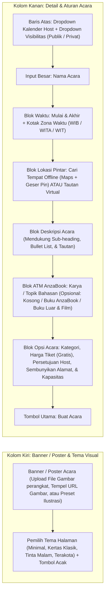
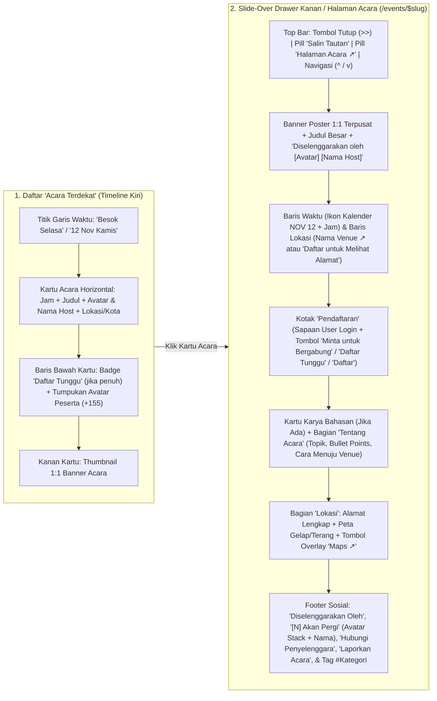
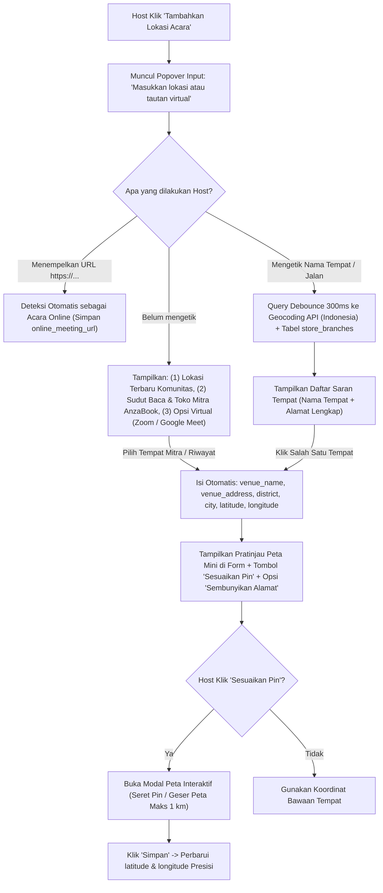
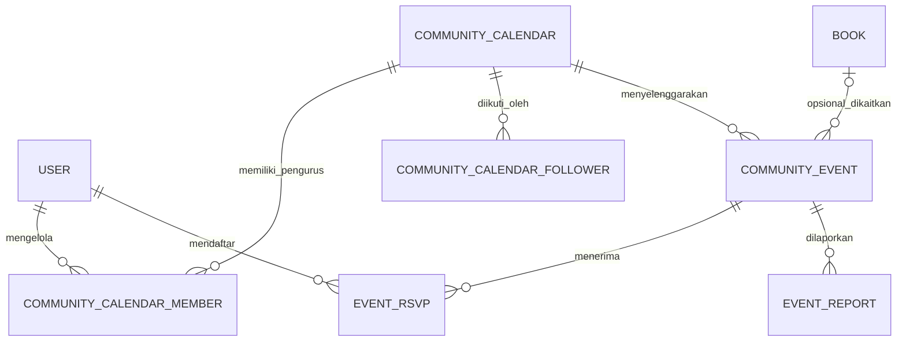

# Rencana Desain & Alur Fitur Komunitas dan Acara (Luma-Inspired)

**Tanggal:** 9 November 2026 (Revisi v3: Timeline Feed, Slide-Over Detail Acara, Kotak Pendaftaran Dinamis, & Privasi Lokasi)  
**Status:** Draft Desain & Arsitektur Final (Fokus Pilar 3: Community Enabler)  
**Referensi Utama:** [`PRD_AnzaBook.md`](file:///d:/Projekan/AnzaBook/PRD_AnzaBook.md), Model Kalender, Studio Buat Acara, & Tampilan Detail Acara Luma (lu.ma)

---

## 1. Tujuan & Prinsip Desain (Revisi v3)

Fitur Komunitas dan Acara di AnzaBook mengadaptasi pengalaman pembuatan, penjelajahan, dan pendaftaran acara **Luma (lu.ma)** dengan penyesuaian (ATM: Amati, Tiru, Modifikasi) untuk ekosistem literasi, diskusi karya, dan komunitas kreatif di Indonesia:

1. **Hanya Host Terverifikasi yang Bisa Membuat Acara Publik:** Pembuatan acara dibatasi untuk **Komunitas / Taman Bacaan Masyarakat (TBM) / Klub Diskusi** dan **Penulis / Penerbit Resmi** agar direktori acara bebas dari spam promosi di luar kegiatan komunitas.
2. **Bebas Topik & Tidak Wajib Mengaitkan Buku Katalog AnzaBook:**
   * Komunitas bebas mengadakan *Bedah Buku* (baik buku yang ada di AnzaBook maupun buku terbitan luar), *Bedah Film*, *Baca Bareng (Silent Reading)*, *Nulis Bareng*, atau *Diskusi Karya*.
   * Pengaitan ke katalog buku AnzaBook bersifat **opsional (bonus ekosistem)**: jika buku yang dibahas ada di katalog AnzaBook, acara otomatis menampilkan tombol **Baca Sampel** dan muncul di halaman detail buku [`/books/$slug`](file:///d:/Projekan/AnzaBook/apps/web/src/routes/books.$slug.tsx). Jika membahas buku luar atau film, host cukup mengisi kartu info karya eksternal secara bebas.
3. **Studio Pembuatan Acara, Peta Geser Pin, & Slide-Over Detail Acara Setara Luma:**
   * Form pembuatan acara 2 kolom dengan unggah banner/poster, pemilih tema, pencarian lokasi offline + modal peta geser pin (maksimal 1 km).
   * Tampilan daftar acara menggunakan **Vertical Timeline Feed** (*Acara Terdekat* per tanggal) yang saat diklik membuka **Slide-Over Detail Drawer** di kanan layar (lengkap dengan tombol `Salin Tautan`, `Halaman Acara ↗`, dan navigasi atas/bawah `^` `v` antar-acara).

---

## 2. Perbandingan Model Luma vs Adaptasi (ATM) AnzaBook

| Komponen | Cara Kerja di Luma (lu.ma) | Adaptasi (ATM) di AnzaBook | Alasan Objektif |
| :--- | :--- | :--- | :--- |
| **Siapa yang Bisa Buat Acara** | Semua pengguna bebas membuat kalender dan acara. | Hanya **Komunitas Terverifikasi** dan **Penulis/Penerbit Resmi**. | Menjaga kualitas direktori acara agar tetap relevan dengan literasi, buku, film, dan kepenulisan. |
| **Kaitan dengan Karya / Buku** | Tidak ada konsep karya/buku (hanya deskripsi teks biasa). | **3 Mode Opsional:** (1) Tanpa karya khusus, (2) Kaitkan Buku Katalog AnzaBook, atau (3) Info Karya Eksternal (Buku Luar / Film / Esai). | Memberi kebebasan penuh bagi komunitas (termasuk bedah film atau buku luar) sambil tetap mengaktifkan *funnel* baca bila bukunya ada di AnzaBook. |
| **Form Buat Acara** | Layout 2 kolom: Banner 1:1 + Tema di kiri, input judul, waktu, lokasi pintar, dan opsi kapasitas di kanan. | Layout 2 kolom identik dengan kompresi Banner Canvas, blok **Karya Bahasan (Opsional)**, dan opsi **Sembunyikan Alamat Sebelum Disetujui**. | Pengalaman buat acara terasa cepat (< 2 menit), bersih, dan visualnya langsung terlihat seperti halaman jadinya. |
| **Penentuan Lokasi Offline** | Ketik nama tempat -> pilih dari autocomplete -> muncul peta kecil -> klik **Sesuaikan Pin** untuk geser pin maks 1 km. | Sama persis: Autocomplete alamat (Nominatim/Photon OSM + Sudut Baca Mitra) + Modal **Sesuaikan Pin** dengan peta interaktif. | Banyak acara komunitas diadakan di taman, perpustakaan, atau kedai kopi lokal yang titik koordinatnya perlu digeser manual agar akurat. |
| **Daftar & Detail Acara** | Daftar acara bergaris waktu vertikal; klik kartu membuka *Slide-Over Drawer* di kanan atau halaman penuh `/events/$slug`. | Sama persis: Timeline *Acara Terdekat* + *Slide-Over Drawer* dengan kotak **Pendaftaran** kontekstual (`Minta untuk Bergabung`, `Daftar Tunggu`, `Daftar`). | Pengguna bisa mengintip banyak acara dengan cepat lewat tombol `^`/`v` di drawer tanpa bolak-balik halaman. |
| **Check-in Kehadiran** | Scan QR tiket peserta melalui aplikasi host. | Memanfaatkan **Kartu Identitas Pembaca QR** ([`qr-profile-dialog.tsx`](file:///d:/Projekan/AnzaBook/apps/web/src/features/dashboard/components/qr-profile-dialog.tsx)) atau kode RSVP 6 digit. | Memakai komponen QR yang sudah tersedia di AnzaBook dan memicu hadiah kartu **Flex Your Reading**. |

---

## 3. Bedah Desain Form "Buat Acara" (ATM dari Luma)

Berdasarkan referensi layar Luma, halaman pembuatan acara dirancang menggunakan tata letak 2 kolom di desktop dan 1 kolom di ponsel:

### Detail Komponen Form:

1. **Input Gambar Banner / Poster Acara (Kolom Kiri Atas):**
   * Saat menekan ikon gambar di pojok kanan bawah kotak banner, host diberi 3 opsi praktis:
     1. **Unggah dari Perangkat (Upload File PNG/JPG/WebP):** Gambar dipratinjau secara langsung dan dikompresi otomatis menggunakan HTML5 Canvas di sisi peramban (mengikuti pola kompresi di [`dashboard-settings.tsx`](file:///d:/Projekan/AnzaBook/apps/web/src/features/dashboard/components/dashboard-settings.tsx#L32-L71)) agar ukuran payload tetap di bawah batas 100 kB API.
     2. **Tempel Tautan Gambar (Image URL):** Mendukung URL banner eksternal.
     3. **Galeri Preset Banner AnzaBook:** Kumpulan ilustrasi bertema buku, diskusi malam, film, dan mesin ketik.
2. **Header Pemilih Kalender & Visibilitas:**
   * **Dropdown Kiri (`Kalender Host`):** Memilih atas nama siapa acara diterbitkan.
   * **Dropdown Kanan (`Publik` / `Privat`):** Acara `Publik` tampil di direktori `Agenda` dan `Home`. Acara `Privat` hanya bisa diakses lewat tautan langsung `/events/$slug`.
3. **Blok Waktu & Zona Waktu:**
   * Kiri: Titik terhubung `Mulai` (Tanggal & Jam) dan `Akhir` (Tanggal & Jam).
   * Kanan: Kotak Zona Waktu (`GMT+07:00 Jakarta`, `GMT+08:00 Makassar`, `GMT+09:00 Jayapura`).
4. **Blok ATM AnzaBook: `Karya atau Topik Bahasan (Opsional)`:**
   * Tidak wajib diisi. Jika diisi, bisa memilih **Buku dari Katalog AnzaBook** atau mengisi **Karya Eksternal** (*Buku Luar*, *Film*, *Esai/Artikel*).
5. **Blok Opsi Acara:**
   * **Harga Tiket:** Default `Gratis`.
   * **Memerlukan Persetujuan (`requiresApproval`):** Toggle switch. Jika aktif, pendaftar berstatus *Menunggu Persetujuan* dan tombol pendaftaran bertuliskan **`Minta untuk Bergabung`**.
   * **Sembunyikan Alamat Sampai Disetujui (`hideAddressUntilApproved`):** Opsional untuk acara offline privat/terbatas. Jika aktif, pengunjung yang belum terdaftar hanya melihat nama Kecamatan/Kota dan pesan *"Daftar untuk Melihat Alamat"*.
   * **Kapasitas (`capacity`):** Default `Tak terbatas` atau angka kuota kursi dengan dukungan otomatis **Daftar Tunggu (`Waitlist`)** saat kursi penuh.

---

## 4. Bedah Tampilan Ketika Acara Sudah Dibuat (Timeline Feed, Slide-Over Drawer, & Halaman Acara)

Mengikuti 5 tangkapan layar tampilan acara Luma yang menjadi acuan, berikut anatomi tampilan saat acara sudah tayang:

### Detail Empat State pada Kotak `Pendaftaran`:

1. **State 1: Memerlukan Persetujuan Host (`requiresApproval = true`):**
   * Header info di dalam kotak: Ikon user-check + **`Persetujuan Diperlukan`** (*"Pendaftaran Anda memerlukan persetujuan host."*).
   * Sapaan personal: *"Selamat datang, [Nama User]! Untuk mengikuti acara ini, silakan daftar di bawah."* beserta Avatar & Email user.
   * Tombol aksi penuh: **`Minta untuk Bergabung`**.
2. **State 2: Acara Penuh & Daftar Tunggu Aktif (`goingCount >= capacity`):**
   * Header info di dalam kotak: Ikon tiket + **`Acara Penuh`** (*"Jika Anda mau, Anda bisa bergabung dengan daftar tunggu."*).
   * Pesan: *"Silakan klik tombol di bawah ini untuk bergabung dengan daftar tunggu. Anda akan diberitahu jika tempat tambahan tersedia."* beserta Avatar & Email user.
   * Tombol aksi penuh: **`Daftar Tunggu`**.
3. **State 3: Kursi Tersedia & Persetujuan Otomatis (`requiresApproval = false`):**
   * Sapaan personal beserta Avatar & Email user.
   * Tombol aksi penuh: **`Daftar Acara`**.
4. **State 4: Pengguna Sudah Terdaftar (`going` / `pending_approval` / `waitlisted`):**
   * Menampilkan badge status pendaftaran saat ini, kode/tombol **Tiket QR Check-in**, alamat lengkap / tautan rapat daring (jika berstatus `going`), serta tombol sekunder **Batalkan Pendaftaran**.

### Detail Privasi Lokasi & Peta di Halaman Acara:

* **Jika Alamat Terbuka (`hideAddressUntilApproved = false` atau peserta sudah `going`):**
  * Menampilkan nama gedung/tempat lengkap dengan panah tautan (`GoWork Menara Rajawali - Coworking and Office Space ↗`), alamat jalan lengkap, dan peta dengan pin lokasi tepat serta tombol overlay **`Maps ↗`** di pojok kiri atas peta yang membuka Google Maps (`https://www.google.com/maps/search/?api=1&query=lat,lng`).
* **Jika Alamat Disembunyikan Sebelum Terdaftar (`hideAddressUntilApproved = true` dan peserta belum `going`):**
  * Di bagian atas menampilkan **`Daftar untuk Melihat Alamat`** beserta nama Kecamatan/Kota saja (misal: *Kecamatan Setiabudi, Daerah Khusus Ibukota Jakarta*).
  * Di bagian Lokasi bawah menampilkan pesan **`Harap mendaftar untuk melihat lokasi tepat acara ini`**, serta peta hanya menampilkan area umum kecamatan/kota tanpa membocorkan nama gedung atau koordinat presisi.

---

## 5. Arsitektur Teknis Lokasi Offline, Pencarian Peta, & Modal "Sesuaikan Pin"

### 5.1 Alur Interaksi Pemilihan Lokasi (Unified Location Popover)

---

## 6. Rencana Tata Letak Navigasi & Layar Aplikasi

1. **Navigasi Utama ([`app-sidebar.tsx`](file:///d:/Projekan/AnzaBook/apps/web/src/features/dashboard/components/app-sidebar.tsx) & [`app.tsx`](file:///d:/Projekan/AnzaBook/apps/web/src/routes/_protected/app.tsx)):**
   Menambahkan tab ke-5 **`Agenda`** di antara `Explore` dan `Library` (`Home`, `Explore`, `Agenda`, `Library`, `Settings`).
2. **Tampilan di Tab `Agenda` (`/app?tab=events`):**
   * Menampilkan daftar **Acara Terdekat** dengan garis waktu vertikal (*Besok Selasa*, *12 Nov Kamis*, dst.) persis referensi Luma.
   * Saat pengguna mengklik salah satu kartu acara di daftar, **Slide-Over Detail Drawer** terbuka dari sisi kanan layar (dengan tombol `Salin Tautan`, `Halaman Acara ↗`, dan tombol `^`/`v` untuk pindah ke acara di atas/bawahnya).
3. **Halaman Publik Mandiri (`/events/$slug` & `/c/$slug`):**
   * Ketika pengguna menekan tombol `Halaman Acara ↗` atau membuka tautan yang dibagikan di WhatsApp/Instagram, mereka masuk ke halaman penuh `/events/$slug` yang menyajikan seluruh informasi acara dengan tata letak bersih.
4. **Tampilan di Tab `Home` ([`dashboard-home.tsx`](file:///d:/Projekan/AnzaBook/apps/web/src/features/dashboard/components/dashboard-home.tsx)) & Halaman Buku ([`books.$slug.tsx`](file:///d:/Projekan/AnzaBook/apps/web/src/routes/books.$slug.tsx)):**
   * Di `Home`: Kartu pengingat RSVP terdekat + daftar ringkas *Acara Terdekat*.
   * Di `/books/$slug`: Bagian *Acara Membahas Buku Ini* khusus untuk acara yang mengaitkan `book_id` buku tersebut.

---

## 7. Rancangan Skema Database Baru (Drizzle PostgreSQL)

### Detail Tabel:
1. **`community_calendars` (Profil Kalender Host):**
   * `id` (uuid, PK), `slug` (varchar, unique)
   * `name` (varchar), `type` (`"community"` | `"author"` | `"publisher"`)
   * `description` (text), `avatar_url` (text), `cover_url` (text), `city` (varchar), `contact_email` (varchar), `social_links` (jsonb)
   * `verification_status` (`"pending"` | `"verified"` | `"trusted"` | `"rejected"`)
   * `created_by_user_id` (fk -> `user.id`), `created_at`, `updated_at`
2. **`community_calendar_members` (Pengurus / Co-Host):**
   * `id` (uuid, PK), `calendar_id` (fk -> `community_calendars.id`), `user_id` (fk -> `user.id`)
   * `role` (`"owner"` | `"admin"` | `"checkin_staff"`)
3. **`community_events` (Agenda Acara):**
   * `id` (uuid, PK), `slug` (varchar, unique), `calendar_id` (fk -> `community_calendars.id`)
   * **Relasi Karya (Opsional & Fleksibel):**
     * `book_id` (uuid, **nullable**, fk -> `books.id`)
     * `featured_work` (jsonb, **nullable** - `{ mediaType: "book" | "film" | "article" | "other", title: string, creator?: string, externalUrl?: string }`)
   * **Identitas, Banner, & Visual Luma:**
     * `title` (varchar), `description` (text), `logistics_notes` (text, nullable - *petunjuk cara menuju venue*)
     * `cover_url` (text - *banner 1:1 dari upload Canvas / URL / preset*)
     * `theme_preset` (varchar, default `"minimal"`)
     * `visibility` (`"public"` | `"private_link"`, default `"public"`)
     * `event_type` (`"book_club"` | `"film_discussion"` | `"silent_reading"` | `"book_launch"` | `"writing_session"` | `"community_meetup"`)
     * `category_tag` (varchar, default `"Literasi"` - *ditampilkan sebagai pill `# Kategori` di bagian paling bawah acara*)
     * `co_hosts` (jsonb, default `[]` - *daftar nama & avatar penyelenggara bersama*)
   * **Waktu, Lokasi Peta, & Privasi Alamat:**
     * `starts_at` (timestamptz), `ends_at` (timestamptz), `timezone` (varchar, default `"Asia/Jakarta"`)
     * `format` (`"offline"` | `"online"` | `"hybrid"`)
     * `district` (varchar, nullable - *misal: `"Kecamatan Setiabudi"`*), `city` (varchar, nullable - *misal: `"Daerah Khusus Ibukota Jakarta"`*)
     * `venue_name` (varchar, nullable), `venue_address` (text, nullable)
     * `hide_address_until_approved` (boolean, default `false` - *jika `true`, sembunyikan `venue_name` & `venue_address` dari pengunjung yang belum `going`*)
     * `latitude` (real, nullable), `longitude` (real, nullable)
     * `place_source_lat` (real, nullable), `place_source_lng` (real, nullable)
     * `online_meeting_url` (text, nullable - *hanya dikirim ke pendaftar berstatus `going`*)
   * **Kapasitas & Siklus Acara:**
     * `capacity` (integer, nullable), `requires_approval` (boolean, default `false`), `allow_waitlist` (boolean, default `true`)
     * `status` (`"draft"` | `"pending_review"` | `"published"` | `"canceled"` | `"completed"`)
     * `parent_event_id` (uuid, nullable)
4. **`event_rsvps` (Pendaftaran & Kehadiran Peserta):**
   * `id` (uuid, PK), `event_id` (fk -> `community_events.id`), `user_id` (fk -> `user.id`)
   * `status` (`"going"` | `"pending_approval"` | `"waitlisted"` | `"canceled"` | `"rejected"`)
   * `checkin_code` (varchar, 8 karakter unik)
   * `checked_in_at` (timestamptz, nullable), `checked_in_by_user_id` (text, nullable)
5. **`event_reports` (Laporan Acara - [`COM-03`](file:///d:/Projekan/AnzaBook/PRD_AnzaBook.md#L148)):**
   * `id` (uuid, PK), `event_id` (fk -> `community_events.id`), `reporter_user_id` (fk -> `user.id`), `reason` (text), `created_at` (timestamptz)
